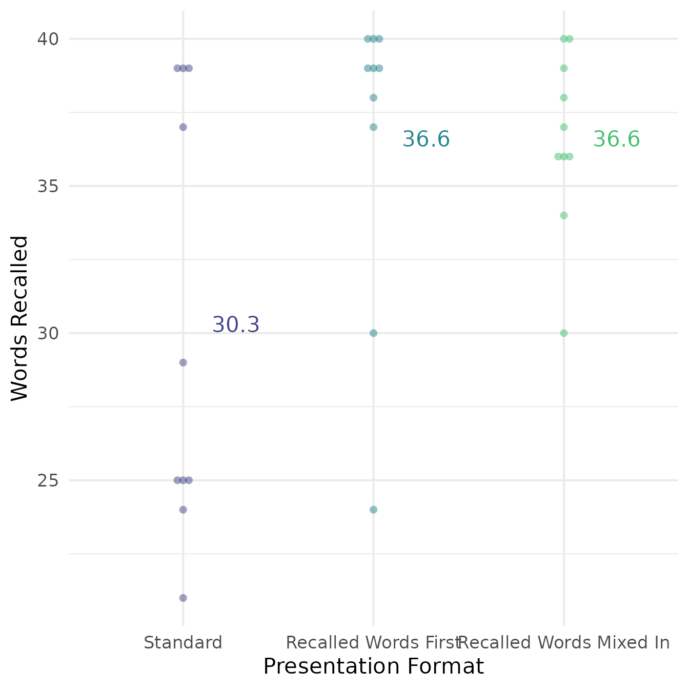
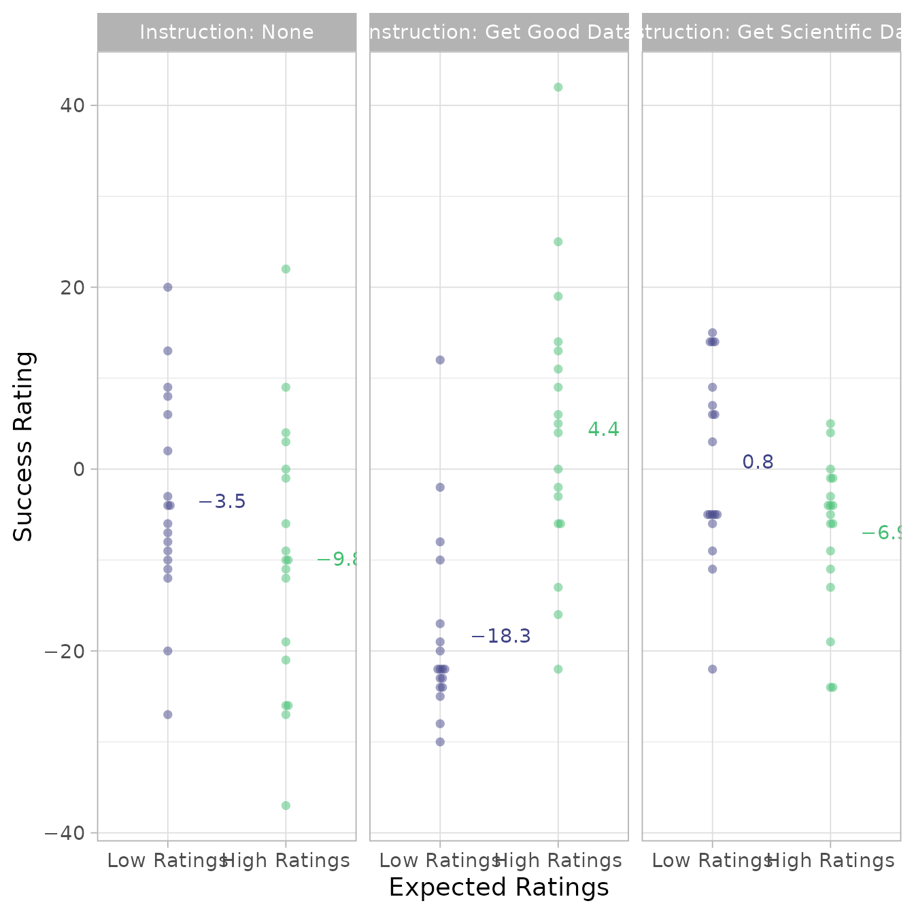
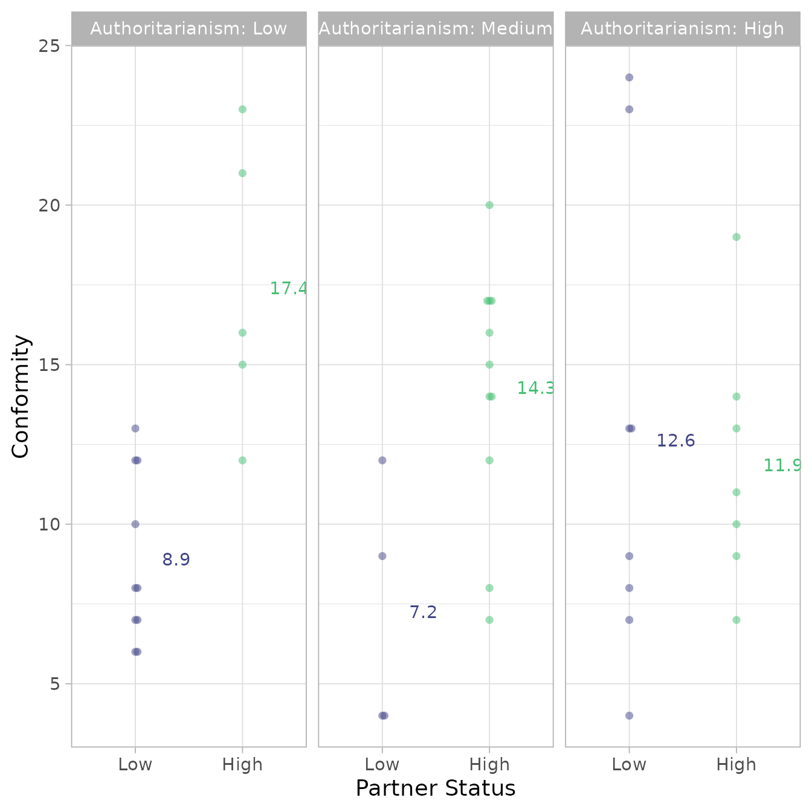

# Analysis of Variance Tables

``` r

library(dplyr)
library(apa7)
library(afex)
library(car)
library(ggplot2)
my_font <- "Roboto Condensed"
apa7_defaults(font_family = "Open Sans", line_spacing = 1.5)
```

The `apa_anova` function makes APA-style analysis of variance (ANOVA)
source tables. Like `apa_parameters`, it relies on the
[easystats](https://easystats.github.io/easystats/) packages to do the
computing:
[`parameters::model_parameters`](https://easystats.github.io/parameters/reference/model_parameters.html)
gets the sums of squares, *F* tests, and *p*-values, and the effectsize
package computes effect sizes and their confidence intervals. The
workflow is the same as for regression tables:

1.  Fit a model with `aov`, `lm`, one of the `afex` functions
    (`aov_car`, `aov_ez`, or `aov_4`), or
    [`lme4::lmer`](https://rdrr.io/pkg/lme4/man/lmer.html).
2.  `apa_anova` converts the fit object into a tibble.
3.  In Quarto and R Markdown documents, the tibble is displayed as an
    APA-style table automatically. Pass it to `apa_flextable` to
    customize the table or save it.

`apa_anova` accepts:

| Object | Example |
|----|----|
| Between-subjects models | `aov(y ~ a * b, data)`, `lm(y ~ a * b, data)` |
| Repeated-measures models with error strata | `aov(y ~ a * b + Error(id / b), data)` |
| `afex` models | `afex::aov_ez("id", "y", data, between = "a", within = "b")` |
| Linear mixed models | `lme4::lmer(y ~ a * b + (1 | id), data)`, `lmerTest::lmer(...)` |
| ANOVA tables | `anova(fit)`, `car::Anova(fit, type = 2)`, `anova(lmerTest_fit)` |

## Between-Subjects Designs

### A one-way design

In the `Friendly` data set from the carData package ([Friendly &
Franklin, 1980](#ref-friendlyInteractivePresentationMultitrial1980)), 30
participants learned a list of 40 words over several trials, 10 in each
of three presentation formats: standard free recall, a format in which
the words a participant had already recalled were presented before the
other words, and a format in which they were mixed in with the other
words. Does the number of words recalled on the final trial differ by
presentation format?

``` r

d_recall <- carData::Friendly |>
  mutate(
    condition = factor(
      condition,
      levels = c("SFR", "Before", "Meshed"),
      labels = c("Standard", "Recalled Words First", "Recalled Words Mixed In")
    )
  ) |>
  rename(
    `Presentation Format` = condition,
    `Words Recalled` = correct
  )

fit_recall <- aov(`Words Recalled` ~ `Presentation Format`, data = d_recall)
```

Code

``` r

d_recall |> 
  ggplot(aes(`Presentation Format`, `Words Recalled`, color = `Presentation Format`)) + 
  # geom_violin() +
  stat_summary(fun.data = mean_cl_normal, position = position_nudge(.1)) +
  stat_summary(fun = mean, geom = "text", aes(label = after_stat(y)), position = position_nudge(.15), hjust = 0, family = my_font) +
  ggbeeswarm::geom_beeswarm(alpha = .5, pch = 16) + 
  theme_minimal(base_family = my_font, base_size = 16) +
  theme(legend.position = "none") + 
  scale_color_viridis_d(begin = .2, end = .7)
```

```
Warning: Computation failed in `stat_summary()`.
Caused by error in `fun.data()`:
! The package "Hmisc" is required.
```



Figure 1

Mean Number of Words Recalled by Presentation Format

``` r

apa_anova(fit_recall)
```

| Source              | SS     | df  | MS     | F    | p   | η2  |
|---------------------|--------|-----|--------|------|-----|-----|
| Presentation Format | 264.60 |  2  | 132.30 | 4.34 | .02 | .24 |
| Error               | 822.90 | 27  |  30.48 |      |     |     |

Table 1

One-Way ANOVA Table

The table has a row for each effect and a row for the error term (the
residuals). Its columns are the sums of squares (*SS*), degrees of
freedom (*df*), mean squares (*MS*), the *F* test with its *p*-value,
and eta squared (*η*²). The default effect size is partial *η*², but in
a one-way design, partial and non-partial *η*² are the same, so the
column is labeled *η*².

In the console, `apa_anova` prints as an ordinary tibble, so you can
inspect it or post-process it with dplyr. Here `as_tibble` is used to
show that tibble in this document.

``` r

apa_anova(fit_recall) |>
  tibble::as_tibble()
```

    # A tibble: 2 × 7
      Source              `*SS*` `*df*` `*MS*` `*F*`  `*p*` `*&eta;*^2^`
      <chr>               <chr>  <chr>  <chr>  <chr>  <chr> <chr>
    1 Presentation Format 264.60  2     132.30 "4.34" ".02" ".24"
    2 Error               822.90 27      30.48 ""     ""    ""          

Table 2

The One-Way ANOVA Table as a Tibble

In follow-up tests using `apa_contrast`, we can see that performance was
lower in the standard condition, compared to the other conditions, which
had equal means:

``` r

apa_contrasts(fit_recall, 
              contrast = `Presentation Format`, 
              p_adjust = "tukey",
              effect_size = FALSE) |> 
  mutate(`Presentation Format` = stringr::str_remove(
    `Presentation Format`, 
    "Recalled Words ")) |> 
  apa_flextable(note = TRUE)
```

| Presentation Format | Difference | SE | 95% CI | t(27) | p |
|----|----|----|----|----|----|
| First − Standard | 6.30 | 2.47 | \[ 1.23, 11.37\] | 2.55 |  .04 |
| Mixed In − Standard | 6.30 | 2.47 | \[ 1.23, 11.37\] | 2.55 |  .04 |
| Mixed In − Recalled Words First | 0.00 | 2.47 | \[−5.07,  5.07\] | 0.00 | \>.99 |
| Note. Values are differences between estimated marginal means of Words Recalled (the first level minus the second). p-values are adjusted for multiple comparisons with Tukey’s method ([Kramer,](#ref-kramerExtensionMultipleRange1956)[ ](#ref-kramerExtensionMultipleRange1956)[1956](#ref-kramerExtensionMultipleRange1956); [Tukey,](#ref-tukeyProblemMultipleComparisons1994)[ ](#ref-tukeyProblemMultipleComparisons1994)[1953/1994](#ref-tukeyProblemMultipleComparisons1994)). CI = confidence interval. |  |  |  |  |  |

Table 3

Pairwise Comparisons of Words Recalled Between Presentation Formats

### A factorial design

The `Adler` data set from the carData package comes from a study of
experimenter expectancy effects ([Adler,
1973](#ref-adlerImpactPriorSets1973)), in a simplified version from
Erickson and Nosanchuk ([1977](#ref-ericksonUnderstandingData1977)).
Experimenters collected ratings of how successful people in photographs
appeared to be. The photographs had been chosen because the people in
them looked neither especially successful nor unsuccessful. Before
collecting the data, the experimenters were told to expect either high
or low ratings, and they were told to get good data, to get scientific
data, or were given no such instruction. The outcome is the average
success rating each experimenter obtained.

``` r

d_adler <- carData::Adler |>
  mutate(
    instruction = factor(
      instruction,
      levels = c("none", "good", "scientific"),
      labels = c("None", "Get Good Data", "Get Scientific Data")
    ),
    expectation = factor(
      expectation,
      levels = c("low", "high"),
      labels = c("Low Ratings", "High Ratings")
    )
  ) |>
  rename(
    Instruction = instruction,
    `Expected Ratings` = expectation,
    `Success Rating` = rating
  )
```

``` r

d_adler |> 
  ggplot(aes(`Expected Ratings` , `Success Rating`, color = `Expected Ratings`)) + 
  # geom_violin() +
  stat_summary(fun.data = mean_cl_normal, position = position_nudge(.15)) +
  stat_summary(fun = mean, geom = "text", aes(label = after_stat(y) |> signs::signs(accuracy = .1)), position = position_nudge(.25), hjust = 0, family = my_font, size = .8 * 14 / ggplot2::.pt) +
  ggbeeswarm::geom_beeswarm(alpha = .5, pch = 16) + 
  theme_light(base_family = my_font, base_size = 14) +
  theme(legend.position = "none") + 
  scale_color_viridis_d(begin = .2, end = .7) + 
  facet_grid(cols = vars(Instruction), labeller = "label_both") + 
  scale_y_continuous(labels = signs::signs)
```

```
Warning: Computation failed in `stat_summary()`.
Computation failed in `stat_summary()`.
Computation failed in `stat_summary()`.
Caused by error in `fun.data()`:
! The package "Hmisc" is required.
```



Figure 2

Mean Success Ratings Across Expected Ratings and Instructions

The factorial model tests both main effects and their interaction.
Interaction terms are labeled with a multiplication sign (e.g.,
Instruction × Expected Ratings).

``` r

fit_adler <- aov(`Success Rating` ~ Instruction * `Expected Ratings`, data = d_adler)
apa_anova(fit_adler)
```

| Source                         | SS        | df  | MS       | F     | p      | η2p |
|--------------------------------|-----------|-----|----------|-------|--------|-----|
| Instruction                    |    336.13 |   2 |   168.06 |  1.15 |  .32   | .02 |
| Expected Ratings               |    222.45 |   1 |   222.45 |  1.52 |  .22   | .01 |
| Instruction × Expected Ratings |  5,329.69 |   2 | 2,664.84 | 18.25 | \<.001 | .26 |
| Error                          | 14,890.50 | 102 |   145.99 |       |        |     |

Table 4

Analysis of Variance of Success Ratings by Instruction and Expected
Ratings

### Choosing columns

The `anova_parameters` argument selects the columns and their order.
`"Effect_Size"` stands for whichever effect size is selected (see
below), and `"CI"` adds its confidence interval. Columns are labeled by
`apa_anova` automatically.

``` r

apa_anova(
  fit_adler,
  anova_parameters = c("Parameter", "df", "F", "p", "Effect_Size")
)
```

| Source                         | df  | F     | p      | η2p |
|--------------------------------|-----|-------|--------|-----|
| Instruction                    |   2 |  1.15 |  .32   | .02 |
| Expected Ratings               |   1 |  1.52 |  .22   | .01 |
| Instruction × Expected Ratings |   2 | 18.25 | \<.001 | .26 |
| Error                          | 102 |       |        |     |

Table 5

Analysis of Variance of Success Ratings With Selected Columns

To mark significant effects, `starred` adds significance stars to a
column, and `bolded` bolds the values of a column when the effect is
significant. Columns are named as in `anova_parameters` (e.g.,
`"Parameter"` for the Source column).

``` r

apa_anova(fit_adler, starred = "F")
```

| Source                         | SS        | df  | MS       | F           | p      | η2p |
|--------------------------------|-----------|-----|----------|-------------|--------|-----|
| Instruction                    |    336.13 |   2 |   168.06 |  1.15       |  .32   | .02 |
| Expected Ratings               |    222.45 |   1 |   222.45 |  1.52       |  .22   | .01 |
| Instruction × Expected Ratings |  5,329.69 |   2 | 2,664.84 | 18.25\*\*\* | \<.001 | .26 |
| Error                          | 14,890.50 | 102 |   145.99 |             |        |     |

Table 6

Analysis of Variance of Success Ratings With Significance Stars

## Effect Sizes

### Choosing an effect size

By default, `apa_anova` displays partial eta squared (*η*²_(p)), the
most commonly reported effect size in psychology. Partial *η*² is the
proportion of variance explained by an effect after the variance
explained by the other effects is set aside. Other effect sizes are
available with the `effect_size`, `partial`, and `generalized`
arguments:

| Arguments                                 | Effect size                 |
|-------------------------------------------|-----------------------------|
| `effect_size = "eta"` (default)           | partial *η*² (*η*²_(p))     |
| `effect_size = "eta", partial = FALSE`    | *η*²                        |
| `effect_size = "eta", generalized = TRUE` | generalized *η*² (*η*²_(G)) |
| `effect_size = "omega"`                   | *ω*²_(p)                    |
| `effect_size = "omega", partial = FALSE`  | partial *ω*² (*ω*²_(p))     |
| `effect_size = "epsilon"`                 | partial *ε*² (*ε*²_(p))     |
| `effect_size = NULL`                      | no effect size              |

*η*² overestimates the population effect size in small samples. *ω*² and
*ε*² are less biased, so they are good choices for small samples.

``` r

apa_anova(fit_adler, effect_size = "omega")
```

| Source                         | SS        | df  | MS       | F     | p      | ω2p |
|--------------------------------|-----------|-----|----------|-------|--------|-----|
| Instruction                    |    336.13 |   2 |   168.06 |  1.15 |  .32   | .00 |
| Expected Ratings               |    222.45 |   1 |   222.45 |  1.52 |  .22   | .00 |
| Instruction × Expected Ratings |  5,329.69 |   2 | 2,664.84 | 18.25 | \<.001 | .24 |
| Error                          | 14,890.50 | 102 |   145.99 |       |        |     |

Table 7

Analysis of Variance of Success Ratings With Partial Omega Squared

Generalized *η*²([Olejnik & Algina,
2003](#ref-olejnikGeneralizedEtaOmega2003)) is comparable across designs
with different numbers of between- and within-subjects factors, which
makes it useful for meta-analysis and for comparing studies. It is the
default effect size in afex.

### Confidence intervals

APA style recommends reporting confidence intervals for effect sizes.
Add `"CI"` to `anova_parameters` to show them.

``` r

apa_anova(
  fit_adler,
  anova_parameters = c(
    "Parameter", "df", "F", "p", "Effect_Size", "CI"
  ),
  ci = 0.90
)
```

| Source                         | df  | F     | p      | η2p | 90% CI       |
|--------------------------------|-----|-------|--------|-----|--------------|
| Instruction                    |   2 |  1.15 |  .32   | .02 | \[.00, .08\] |
| Expected Ratings               |   1 |  1.52 |  .22   | .01 | \[.00, .08\] |
| Instruction × Expected Ratings |   2 | 18.25 | \<.001 | .26 | \[.14, .37\] |
| Error                          | 102 |       |        |     |              |

Table 8

Analysis of Variance of Success Ratings With 90% Confidence Intervals
for Partial Eta Squared

Intervals are two-sided. Because *F* tests are one-sided, a 90% interval
is a natural companion to an *F* test with *α* = .05: the interval
excludes 0 if and only if the *F* test is significant ([Steiger,
2004](#ref-steigerTestEffectSize2004)). Its lower bound is 0 when the
test is not significant. Set `ci = 0.95` for 95% intervals.

Intervals are not shown for generalized *η*², because the intervals
computed by effectsize for it can exclude the point estimate. If you
request them, `apa_anova` gives a warning and leaves them out.

## Unbalanced Designs and Types of Sums of Squares

When cell sizes are unequal, the effects in a factorial design are
correlated, and the sums of squares depend on how the variance they
share is divided. In the `Moore` data set from the carData package,
participants were paired with a partner of high or low status, and the
number of times they conformed to their partner’s judgments was
recorded. Participants’ authoritarianism was classified as low, medium,
or high. The cell sizes are unequal:

``` r

d_moore <- carData::Moore |>
  mutate(
    fcategory = factor(fcategory, 
                       levels = c("low", "medium", "high"),
                       labels = c("Low", "Medium", "High")),
    partner.status = factor(partner.status, 
                            levels = c("low", "high"),
                            labels = c("Low", "High"))
  ) |>
  rename(
    Authoritarianism = fcategory,
    `Authoritarianism Score` = fscore,
    `Partner Status` = partner.status
  )

table(d_moore$Authoritarianism, d_moore$`Partner Status`)
```

```

         Low High
  Low     10    5
  Medium   4   11
  High     8    7
```

``` r

d_moore |> 
  # rename(`Participant Authoritarianism` = Authoritarianism) |> 
  ggplot(aes(`Partner Status` , conformity, color = `Partner Status`)) + 
  # geom_violin() +
  stat_summary(fun.data = mean_cl_normal, position = position_nudge(.15)) +
  stat_summary(fun = mean, geom = "text", aes(label = after_stat(y) |> signs::signs(accuracy = .1)), position = position_nudge(.25), hjust = 0, family = my_font, size = .8 * 14 / ggplot2::.pt) +
  ggbeeswarm::geom_beeswarm(alpha = .5, pch = 16) + 
  theme_light(base_family = my_font, base_size = 14) +
  theme(legend.position = "none") + 
  scale_color_viridis_d(begin = .2, end = .7) + 
  facet_grid(cols = vars(`Authoritarianism`), labeller = "label_both") + 
  scale_y_continuous("Conformity", labels = signs::signs) 
```

```
Warning: Computation failed in `stat_summary()`.
Computation failed in `stat_summary()`.
Computation failed in `stat_summary()`.
Caused by error in `fun.data()`:
! The package "Hmisc" is required.
```



Figure 3

Mean Conformity Across Participant and Partner Authoritarianism

By default, `apa_anova` uses Type 1 (sequential) sums of squares, as
`anova` and `summary.aov` do. Each effect is adjusted only for the
effects entered before it, so the results depend on the order of the
terms in the formula.

``` r

fit_moore <- lm(conformity ~ Authoritarianism * `Partner Status`, data = d_moore)
apa_anova(fit_moore)
```

| Source                            | SS     | df  | MS     | F     | p    | η2p |
|-----------------------------------|--------|-----|--------|-------|------|-----|
| Authoritarianism                  |   3.73 |  2  |   1.87 |  0.09 | .92  | .00 |
| Partner Status                    | 212.21 |  1  | 212.21 | 10.12 | .003 | .21 |
| Authoritarianism × Partner Status | 175.49 |  2  |  87.74 |  4.18 | .02  | .18 |
| Error                             | 817.76 | 39  |  20.97 |       |      |     |

Table 9

Analysis of Variance of Conformity by Authoritarianism and Partner
Status (Type 1 Sums of Squares)

Set `type = 2` or `type = 3` for Type 2 or Type 3 sums of squares, which
are computed with
[`car::Anova`](https://rdrr.io/pkg/car/man/Anova.html). Type 2 tests
adjust each main effect for the other main effects but not for the
interaction, which is appropriate when the interaction is negligible.

``` r

apa_anova(fit_moore, type = 2)
```

| Source                            | SS     | df  | MS     | F     | p    | η2p |
|-----------------------------------|--------|-----|--------|-------|------|-----|
| Authoritarianism                  |  11.61 |  2  |   5.81 |  0.28 | .76  | .01 |
| Partner Status                    | 212.21 |  1  | 212.21 | 10.12 | .003 | .21 |
| Authoritarianism × Partner Status | 175.49 |  2  |  87.74 |  4.18 | .02  | .18 |
| Error                             | 817.76 | 39  |  20.97 |       |      |     |

Table 10

Analysis of Variance of Conformity by Authoritarianism and Partner
Status (Type 2 Sums of Squares)

Type 3 tests adjust each effect for all other effects, including
interactions. Type 3 tests are meaningful only when factors are coded
with contrasts that sum to zero (e.g., `contr.sum`), not with R’s
default treatment contrasts, so set the contrasts before fitting the
model:

``` r

fit_moore_sum <- lm(
  conformity ~ Authoritarianism * `Partner Status`,
  data = d_moore,
  contrasts = list(Authoritarianism = contr.sum, `Partner Status` = contr.sum)
)
apa_anova(fit_moore_sum, type = 3)
```

| Source                            | SS     | df  | MS     | F     | p    | η2p |
|-----------------------------------|--------|-----|--------|-------|------|-----|
| Authoritarianism                  |  36.02 |  2  |  18.01 |  0.86 | .43  | .04 |
| Partner Status                    | 239.56 |  1  | 239.56 | 11.42 | .002 | .23 |
| Authoritarianism × Partner Status | 175.49 |  2  |  87.74 |  4.18 | .02  | .18 |
| Error                             | 817.76 | 39  |  20.97 |       |      |     |

Table 11

Analysis of Variance of Conformity by Authoritarianism and Partner
Status (Type 3 Sums of Squares)

A table from [`car::Anova`](https://rdrr.io/pkg/car/man/Anova.html) or
`anova` can also be passed to `apa_anova` directly. It already has a
type of sums of squares, so the `type` argument is not needed.

``` r

car::Anova(fit_moore, type = 2) |>
  apa_anova()
```

| Source                            | SS     | df  | MS     | F     | p    | η2p |
|-----------------------------------|--------|-----|--------|-------|------|-----|
| Authoritarianism                  |  11.61 |  2  |   5.81 |  0.28 | .76  | .01 |
| Partner Status                    | 212.21 |  1  | 212.21 | 10.12 | .003 | .21 |
| Authoritarianism × Partner Status | 175.49 |  2  |  87.74 |  4.18 | .02  | .18 |
| Error                             | 817.76 | 39  |  20.97 |       |      |     |

Table 12

Type 2 Analysis of Variance of Conformity Computed With
[`car::Anova`](https://rdrr.io/pkg/car/man/Anova.html)

``` r

apa_contrasts(fit_moore, contrast = `Partner Status`, by = Authoritarianism, effect_size = FALSE) |> 
  apa_flextable(note = TRUE)
```

| Partner Status | Difference | SE | 95% CI | t(39) | p |
|----|----|----|----|----|----|
| Authoritarianism: Low |  |  |  |  |  |
|  High − Low |  8.50 | 2.51 | \[ 3.43, 13.57\] |  3.39 | .002 |
| Authoritarianism: Medium |  |  |  |  |  |
|  High − Low |  7.02 | 2.67 | \[ 1.61, 12.43\] |  2.63 | .01  |
| Authoritarianism: High |  |  |  |  |  |
|  High − Low | −0.77 | 2.37 | \[−5.56,  4.03\] | −0.32 | .75  |
| Note. Values are differences between estimated marginal means of Conformity (the first level minus the second). p-values are not adjusted for multiple comparisons. CI = confidence interval. |  |  |  |  |  |

Table 13

Effect of Partner Status on Conformity at Each Level of Authoritarianism

## Analysis of Covariance

An analysis of covariance (ANCOVA) is an ANOVA with one or more
continuous covariates. Fit it with `lm` or `aov`. Here, partner status
is tested while controlling for participants’ authoritarianism scores.
Type 2 sums of squares adjust each effect for the other, regardless of
the order of the terms.

``` r

fit_ancova <- lm(conformity ~ `Authoritarianism Score` + `Partner Status`, data = d_moore)
apa_anova(fit_ancova, type = 2)
```

| Source                 | SS       | df  | MS     | F    | p    | η2p |
|------------------------|----------|-----|--------|------|------|-----|
| Authoritarianism Score |     0.63 |  1  |   0.63 | 0.03 | .87  | .00 |
| Partner Status         |   204.83 |  1  | 204.83 | 8.57 | .005 | .17 |
| Error                  | 1,004.24 | 42  |  23.91 |      |      |     |

Table 14

Analysis of Covariance of Conformity by Partner Status, Controlling for
Authoritarianism Score

## Repeated-Measures Designs

### Error strata with `aov`

In the `obk.long` data set from the afex package ([O’Brien & Kaiser,
1985](#ref-obrienMANOVAMethodAnalyzing1985)), 16 participants in three
treatment groups were measured before treatment, after treatment, and at
follow-up. Each phase had five measurements, which we average here.

``` r

d_obk <- obk.long |>
  mutate(phase = factor(phase, levels = c("pre", "post", "fup"))) |>
  summarise(value = mean(value), .by = c(id, treatment, phase)) |>
  rename(Treatment = treatment, Phase = phase)
```

In base R, a mixed design with a between-subjects factor (treatment) and
a within-subjects factor (phase) is fit with `aov` and an `Error` term.
Each error stratum has its own error term. `apa_anova` introduces each
stratum with a heading row and indents its effects.

``` r

fit_obk_aov <- aov(value ~ Treatment * Phase + Error(id / Phase), data = d_obk)
apa_anova(fit_obk_aov)
```

| Source             | SS    | df  | MS    | F     | p      | η2p |
|--------------------|-------|-----|-------|-------|--------|-----|
| Between subjects   |       |     |       |       |        |     |
|  Treatment         | 37.35 |  2  | 18.67 |  2.91 |  .09   | .31 |
|  Error             | 83.32 | 13  |  6.41 |       |        |     |
| Within subjects    |       |     |       |       |        |     |
|  Phase             | 33.50 |  2  | 16.75 | 23.63 | \<.001 | .65 |
|  Treatment × Phase | 15.40 |  4  |  3.85 |  5.43 |  .003  | .46 |
|  Error             | 18.43 | 26  |  0.71 |       |        |     |

Table 15

Mixed Analysis of Variance of Treatment and Phase With Error Strata

With `aov`, sums of squares are Type 1, and no correction is made for
violations of sphericity.

### afex models

The afex package fits repeated-measures ANOVAs with Type 3 sums of
squares and corrects the degrees of freedom of within-subjects effects
for violations of sphericity (Greenhouse–Geisser by default). In afex
models, each effect has its own error term, so the table shows the
degrees of freedom of each effect and its error term (*df*_(effect) and
*df*_(error)) and the mean squared error (*MSE*), as afex’s `nice`
function does. As in afex, generalized *η*² is the default effect size.

``` r

fit_obk <- aov_ez(
  id = "id",
  dv = "value",
  data = d_obk,
  between = "Treatment",
  within = "Phase"
)
apa_anova(fit_obk)
```

| Effect            | dfeffect | dferror | MSE  | F     | p      | η2G |
|-------------------|----------|---------|------|-------|--------|-----|
| Treatment         | 2.00     | 13.00   | 6.41 |  2.91 |  .09   | .27 |
| Phase             | 1.74     | 22.64   | 0.81 | 19.29 | \<.001 | .21 |
| Treatment × Phase | 3.48     | 22.64   | 0.81 |  5.43 |  .004  | .13 |

Table 16

Mixed Analysis of Variance of Treatment and Phase Fit With afex

The degrees of freedom of the within-subjects effects are not whole
numbers because they have been corrected for sphericity. To report
partial *η*² with confidence intervals instead:

``` r

apa_anova(
  fit_obk,
  generalized = FALSE,
  anova_parameters = c(
    "Parameter", "df", "df_error", "F", "p", "Effect_Size", "CI"
  ),
  ci = 0.90
)
```

| Effect            | dfeffect | dferror | F     | p      | η2p | 90% CI       |
|-------------------|----------|---------|-------|--------|-----|--------------|
| Treatment         | 2.00     | 13.00   |  2.91 |  .09   | .31 | \[.00, .56\] |
| Phase             | 1.74     | 22.64   | 19.29 | \<.001 | .60 | \[.37, .72\] |
| Treatment × Phase | 3.48     | 22.64   |  5.43 |  .004  | .46 | \[.15, .61\] |

Table 17

Mixed Analysis of Variance of Treatment and Phase With Partial Eta
Squared and 90% Confidence Intervals

The sphericity correction is set when the model is fit or printed in
afex (e.g., `afex_options(correction_aov = "none")`).

### Linear mixed models

Repeated-measures ANOVAs need complete data from every participant, and
they average over repeated measurements within each cell. Linear mixed
models fit with [`lme4::lmer`](https://rdrr.io/pkg/lme4/man/lmer.html)
have neither requirement. Here the same O’Brien and Kaiser data are
analyzed without averaging the five measurements within each phase, with
a random intercept for each participant:

``` r

d_obk_trials <- obk.long |>
  mutate(phase = factor(phase, levels = c("pre", "post", "fup"))) |>
  rename(Treatment = treatment, Phase = phase)

fit_obk_lmer <- lme4::lmer(
  value ~ Treatment * Phase + (1 | id),
  data = d_obk_trials
)
apa_anova(fit_obk_lmer)
```

| Effect            | dfeffect | dferror | F     | p      |
|-------------------|----------|---------|-------|--------|
| Treatment         | 2        |  13.00  |  2.91 |  .09   |
| Phase             | 2        | 218.00  | 36.71 | \<.001 |
| Treatment × Phase | 4        | 218.00  | 10.33 | \<.001 |

Table 18

*F* Tests of Treatment and Phase in a Linear Mixed Model

The *F* tests come from the
[lmerTest](https://cran.r-project.org/package=lmerTest) package, which
must be installed. Models fit with
[`lme4::lmer`](https://rdrr.io/pkg/lme4/man/lmer.html) are converted for
lmerTest automatically, and models fit with
[`lmerTest::lmer`](https://rdrr.io/pkg/lmerTest/man/lmer.html) are used
as they are. Mixed models have no simple error terms, so each test’s
denominator degrees of freedom (*df*_(error)) are approximated. By
default, the approximation is Kenward–Roger’s (which requires the
pbkrtest package), as in `apa_parameters`, so tables of the same model’s
*F* tests and coefficients use the same approximation. Satterthwaite’s
approximation, lmerTest’s default, is faster for large data sets:

``` r

tbl_obk_lmer <- apa_anova(fit_obk_lmer, ddf = "Satterthwaite")
apa_note(tbl_obk_lmer)
```

```
[1] "*F* tests of fixed effects are Type III. Denominator degrees of freedom are Satterthwaite approximations [@satterthwaiteApproximateDistributionEstimates1946]."
```

Tests are Type 3 by default, as in lmerTest. lmerTest’s Type 3 tests do
not depend on how factors are coded, so sum-to-zero contrasts are not
needed. Use `type = 2` or `type = 1` for other types.

Sums of squares and effect sizes have no agreed-upon definitions in
mixed models, so they are not shown by default. When a partial effect
size is requested, it is computed from *F* and its degrees of freedom
(e.g.,
[`effectsize::F_to_eta2`](https://easystats.github.io/effectsize/reference/F_to_eta2.html)),
and the note says that it only approximates the effect size:

``` r

apa_anova(
  fit_obk_lmer,
  effect_size = "eta",
  anova_parameters = c(
    "Parameter", "df", "df_error", "F", "p", "Effect_Size", "CI"
  )
) |>
  apa_flextable(note = TRUE)
```

| Effect | dfeffect | dferror | F | p | η2p | 95% CI |
|----|----|----|----|----|----|----|
| Treatment | 2 |  13.00 |  2.91 |  .09  | .31 | \[.00, .60\] |
| Phase | 2 | 218.00 | 36.71 | \<.001 | .25 | \[.16, .34\] |
| Treatment × Phase | 4 | 218.00 | 10.33 | \<.001 | .16 | \[.07, .24\] |
| Note. F tests of fixed effects are Type III. Denominator degrees of freedom are Kenward–Roger approximations ([Kenward](#ref-kenwardSmallSampleInference1997)[ ](#ref-kenwardSmallSampleInference1997)[&](#ref-kenwardSmallSampleInference1997)[ ](#ref-kenwardSmallSampleInference1997)[Roger,](#ref-kenwardSmallSampleInference1997)[ ](#ref-kenwardSmallSampleInference1997)[1997](#ref-kenwardSmallSampleInference1997)). η2p is computed from F and its degrees of freedom, which only approximates it in mixed models. η2p = partial eta squared; CI = confidence interval. |  |  |  |  |  |  |

Table 19

*F* Tests of Treatment and Phase in a Linear Mixed Model With Partial
Eta Squared

ANOVA tables made by lmerTest’s `anova` function are displayed the same
way, with the type of tests and the degrees-of-freedom method read from
the table (e.g., `apa_anova(anova(lmerTest_fit, type = 2))`).
Generalized linear mixed models
([`lme4::glmer`](https://rdrr.io/pkg/lme4/man/glmer.html)) have no *F*
tests. Use `apa_parameters` for them, as described in the [multilevel
article](https://wjschne.github.io/apa7/articles/multilevel.md).

## Customizing ANOVA Tables

### Notes

The table does not say which type of sums of squares or which sphericity
correction was used, so say so in a table note. `apa_anova` records how
the table was made, and `apa_note` turns that record into note text:

``` r

tbl_moore <- apa_anova(fit_moore, type = 2)
apa_note(tbl_moore)
```

```
[1] "Type II sums of squares. *&eta;*^2^~p~ = partial eta squared."
```

The note says which type of sums of squares was used and defines the
effect size. For afex models, it also says which effects have
sphericity-corrected degrees of freedom. afex corrects only effects that
involve a within-subjects factor with more than two levels, so the note
names those factors:

``` r

tbl_obk <- apa_anova(fit_obk, starred = "F")
apa_note(tbl_obk)
```

```
[1] "Type III sums of squares. Degrees of freedom and *p*-values for effects involving Phase are Greenhouse–Geisser corrected [@greenhouseMethodsAnalysisProfile1959]. *MSE* = mean square error; *&eta;*^2^~G~ = generalized eta squared [@olejnikGeneralizedEtaOmega2003]. ^\\* ^*p* ≤ .05. ^\\*\\* ^*p* ≤ .01. ^\\*\\*\\* ^*p* ≤ .001."
```

When stars or bold values are used, the note explains them, after the
general notes as APA style requires. The text is in markdown, and it
does not start with “*Note*.” because apaquarto adds that.

With [apaquarto](https://wjschne.github.io/apaquarto/), use `apa_note`
in the `apa-note` chunk option with `!expr`. Chunk options are evaluated
before the chunk runs, so make the table in an earlier chunk (as
`tbl_obk` was made above) and display it in the chunk with the note.
Write it as
[`apa7::apa_note`](https://wjschne.github.io/apa7/reference/apa_note.md),
because in documents with cached chunks, chunk options can be evaluated
before [`library(apa7)`](https://github.com/wjschne/apa7) takes effect:

```` markdown
```{r}
#| label: tbl-obk
#| tbl-cap: Mixed ANOVA of Treatment and Phase
#| apa-note: !expr apa7::apa_note(tbl_obk)
tbl_obk
```
````

| Effect            | dfeffect | dferror | MSE  | F            | p      | η2G |
|-------------------|----------|---------|------|--------------|--------|-----|
| Treatment         | 2.00     | 13.00   | 6.41 |  2.91        |  .09   | .27 |
| Phase             | 1.74     | 22.64   | 0.81 | 19.29\*\*\*  | \<.001 | .21 |
| Treatment × Phase | 3.48     | 22.64   | 0.81 |  5.43\*\*    |  .004  | .13 |

Table 20

Mixed ANOVA of Treatment and Phase

*Note*. Type III sums of squares. Degrees of freedom and *p*-values for
effects involving Phase are Greenhouse–Geisser corrected ([Greenhouse &
Geisser, 1959](#ref-greenhouseMethodsAnalysisProfile1959)). *MSE* = mean
square error; *η*²_(G) = generalized eta squared ([Olejnik & Algina,
2003](#ref-olejnikGeneralizedEtaOmega2003)). ^(\* )*p* ≤ .05.
^(\*\* )*p* ≤ .01. ^(\*\*\* )*p* ≤ .001.

Without apaquarto, `apa_flextable(tbl, note = TRUE)` puts the same note
below the table (or pass your own text as `note`). Do not combine it
with the `apa-note` chunk option, or the note will appear twice.

The generated note is a starting point. To add to it, combine it with
your own text (e.g.,
`paste(apa_note(tbl_obk), "Outliers were removed.")`). With
`collapse = NULL`, `apa_note` returns one sentence per element, so you
can drop or reword sentences.

`apa_note` reads an attribute of the table. dplyr functions such as
`mutate` and `filter` keep it, but some operations (e.g., joins) drop
it, so call `apa_note` on the table that `apa_anova` returned.

### Labels and post-processing

Variable names are converted to title case (e.g., `correct` would become
Correct). For better labels, rename the variables before fitting the
model, as was done for the Moore data above. Because the output is a
tibble, you can also change the labels afterward.

Further formatting is available with `apa_flextable`.

``` r

apa_anova(fit_adler) |>
  apa_flextable(table_width = .8)
```

| Source                         | SS        | df  | MS       | F     | p      | η2p |
|--------------------------------|-----------|-----|----------|-------|--------|-----|
| Instruction                    |    336.13 |   2 |   168.06 |  1.15 |  .32   | .02 |
| Expected Ratings               |    222.45 |   1 |   222.45 |  1.52 |  .22   | .01 |
| Instruction × Expected Ratings |  5,329.69 |   2 | 2,664.84 | 18.25 | \<.001 | .26 |
| Error                          | 14,890.50 | 102 |   145.99 |       |        |     |

Table 21

Analysis of Variance of Success Ratings Formatted With `apa_flextable`

### Model comparisons

`apa_anova` makes source tables. To compare nested models (e.g.,
`anova(m1, m2)`), use `apa_performance_comparison` or pass a list of
models to `apa_parameters`, as described in the [regression
article](https://wjschne.github.io/apa7/articles/regression.md).

### Using `apa_parameters`

`apa_parameters` returns the same table for `aov` and afex models, so
`apa_parameters(fit)` and `apa_anova(fit)` are interchangeable for these
models. To display the regression coefficients of an ANOVA model, fit it
with `lm` and use `apa_parameters`. For linear mixed models, the two
functions show different things: `apa_anova` tests each effect as a
whole, and `apa_parameters` shows the fixed-effect coefficients and the
random effects.

## References

Adler, N. E. (1973). Impact of prior sets given experimenters and
subjects on the experimenter expectancy effect. *Sociometry*, *36*(1),
113–126. <https://doi.org/10.2307/2786286>

Erickson, B. H., & Nosanchuk, T. A. (1977). *Understanding data*.
McGraw-Hill Ryerson.

Friendly, M., & Franklin, P. (1980). Interactive presentation in
multitrial free recall. *Memory & Cognition*, *8*(3), 265–270.
<https://doi.org/10.3758/BF03197614>

Greenhouse, S. W., & Geisser, S. (1959). On methods in the analysis of
profile data. *Psychometrika*, *24*(2), 95–112.
<https://doi.org/10.1007/BF02289823>

Kenward, M. G., & Roger, J. H. (1997). Small sample inference for fixed
effects from restricted maximum likelihood. *Biometrics*, *53*(3),
983–997. <https://doi.org/10.2307/2533558>

Kramer, C. Y. (1956). Extension of multiple range tests to group means
with unequal numbers of replications. *Biometrics*, *12*(3), 307–310.
<https://doi.org/10.2307/3001469>

O’Brien, R. G., & Kaiser, M. K. (1985). MANOVA method for analyzing
repeated measures designs: An extensive primer. *Psychological
Bulletin*, *97*(2), 316–333.
<https://doi.org/10.1037/0033-2909.97.2.316>

Olejnik, S., & Algina, J. (2003). Generalized eta and omega squared
statistics: Measures of effect size for some common research designs.
*Psychological Methods*, *8*(4), 434–447.
<https://doi.org/10.1037/1082-989X.8.4.434>

Steiger, J. H. (2004). Beyond the *F* test: Effect size confidence
intervals and tests of close fit in the analysis of variance and
contrast analysis. *Psychological Methods*, *9*(2), 164–182.
<https://doi.org/10.1037/1082-989X.9.2.164>

Tukey, J. W. (1994). The problem of multiple comparisons. In H. I. Braun
(Ed.), *The collected works of John W. Tukey: Vol. VIII. Multiple
comparisons, 1948–1983* (pp. 1–300). Chapman & Hall. (Original work
published 1953)
