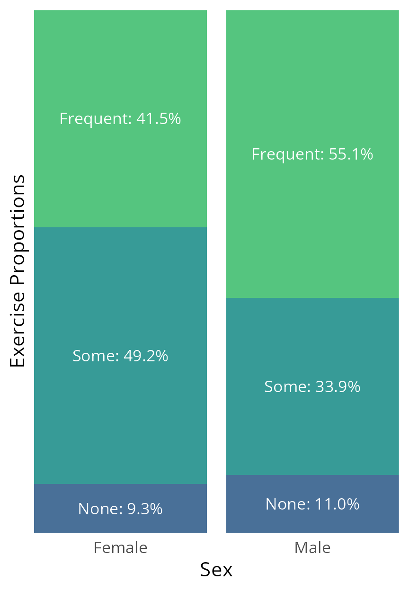
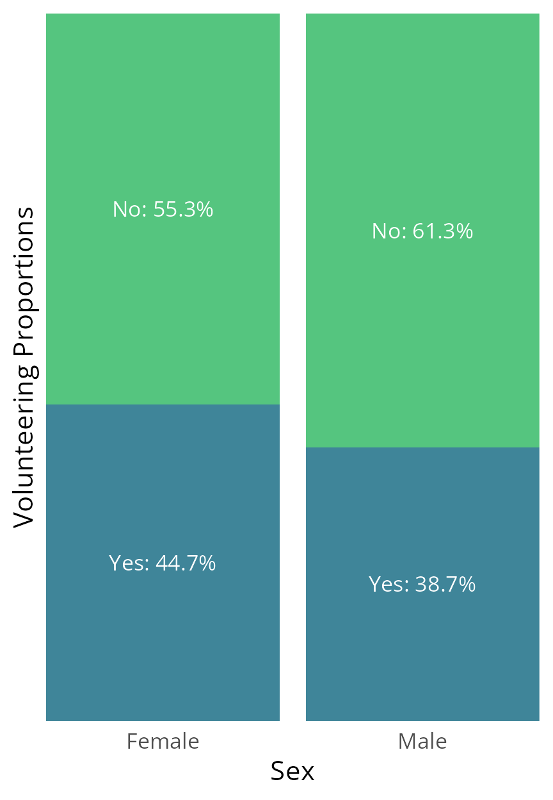

# Contingency Tables

``` r

library(apa7)
library(dplyr)
library(ggplot2)
library(forcats)
apa7_defaults(font_family = "Open Sans", line_spacing = 1.5)
```

A contingency table shows how often each combination of the levels of
two categorical variables occurs. `apa_chisq` makes an APA-style
contingency table with a row for each level of one variable and a column
for each level of the other, tests whether the variables are
independent, and records the result for the table note.

apa7 has three ways to report categorical variables:

| Function | Table | Article |
|----|----|----|
| `apa_chisq` | The cells of one contingency table, with its test of independence in the note | This article |
| `apa_htest(test = "chisq")` | One row per test, for several variables tested against the same grouping variable | [Hypothesis tests](https://wjschne.github.io/apa7/articles/htest.html#chi-square-tests-of-independence) |
| `apa_descriptives` | Counts and percentages of categorical variables, with continuous variables, in a sample description (“Table 1”) | [Descriptive statistics](https://wjschne.github.io/apa7/articles/descriptives.md) |

## The Data

The `survey` data set in the MASS package ([Venables & Ripley,
2002](#ref-ripleyModernApplied2002)) has the answers of 237 statistics
students to a short questionnaire. Do women and men differ in how often
they exercise? Give the variables and their levels names that read well
in a table:

``` r

d_survey <- MASS::survey |>
  transmute(
    Sex,
    Exercise = factor(Exer,
                      levels = c("None", "Some", "Freq"),
                      labels = c("None", "Some", "Frequent")),
    Smoking = factor(Smoke,
                     levels = c("Never", "Occas", "Regul", "Heavy"),
                     labels = c("Never", "Occasionally", "Regularly", "Heavily"))
  )
```

## Plot

First, we visualize the data. An informal inspection of
[Figure 1](#fig-exercise) suggests that compared to females, males are
more likely to exercise frequently. The formal test of the comparison in
[Table 3](#tbl-exercise-flextable) will reveal that the apparent
difference in proportions is not statistically significant.

Code

``` r

d_survey |> 
  filter_out(is.na(Sex)) |> 
  mutate(Exercise = fct_rev(Exercise)) |> 
  count(Sex, Exercise) |> 
  mutate(Proportion = n / sum(n), .by = Sex) |> 
  mutate(p = formatC(100 * Proportion, digits = 1, format = "f")) |> 
  ggplot(aes(Sex, Proportion)) + 
  geom_col(aes(fill = Exercise)) + 
  geom_text(aes(label = paste0(Exercise, ": ", p, "%"), group = Exercise), position = position_stack(vjust = .5, reverse = F), size = 16 * .8, size.unit = "pt", color = "white") + 
  scale_x_discrete(expand = expansion()) +
  scale_y_continuous("Exercise Proportions", breaks = NULL, expand = expansion()) + 
  scale_fill_viridis_d(begin = .3, end = .7, direction = -1, alpha = .9) +
  theme_minimal(base_family = "Open Sans", base_size = 16) + 
  theme(legend.position = "none", panel.grid = element_blank())
```



Figure 1

Exercise Frequency by Participant Sex

## Contingency Table

The `variable` parameter gives the rows of the table, and `by` gives the
columns:

``` r

tbl_exercise <- apa_chisq(d_survey, Exercise, by = Sex)
tbl_exercise
```

| Exercise | Female |       |     | Male |       |     | Total |       |
|----------|--------|-------|-----|------|-------|-----|-------|-------|
|          | n      | %     |     | n    | %     |     | n     | %     |
| None     |  11    |   9.3 |     |  13  |  11.0 |     |  24   |  10.2 |
| Some     |  58    |  49.2 |     |  40  |  33.9 |     |  98   |  41.5 |
| Frequent |  49    |  41.5 |     |  65  |  55.1 |     | 114   |  48.3 |
| Total    | 118    | 100.0 |     | 118  | 100.0 |     | 236   | 100.0 |

Table 1

Exercise by Sex

Each group has a column of counts (*n*) and a column of percentages, and
the “Total” row and column give the marginal counts. By default, the
percentages are of each column’s total, so each group’s distribution can
be read on its own: 41.5% of the women and 55.1% of the men exercised
frequently. Variable names can be quoted or unquoted.

In the console, `apa_chisq` returns an ordinary tibble, which can be
changed with dplyr functions. In Quarto and R Markdown documents, it is
displayed as an APA-style table automatically.

## Table Notes

`apa_chisq` tests whether the two variables are independent, and
`apa_note` writes the note: what the values are, the test and its effect
size, and how many cases were left out because of missing values. The
text is in markdown, and it does not start with “*Note*.” because
apaquarto adds that.

``` r

apa_note(tbl_exercise)
```

```
[1] "Values are counts (*n*) and percentages of each column (each group of Sex). Chi-square test of independence: *&chi;*^2^(2, *N* = 236) = 5.72, *p* = .06, Cramér's *V* = .16. Cases with a missing value of Exercise or Sex (*n* = 1) are not included."
```

With [apaquarto](https://wjschne.github.io/apaquarto/), use `apa_note`
in the `apa-note` chunk option. Chunk options are evaluated before the
chunk runs, so make the table in an earlier chunk (as `tbl_exercise` was
made above):

```` markdown
```{r}
#| label: tbl-exercise-note
#| apa7-width: landscape
#| tbl-cap: "Exercise by Sex With a Note"
#| apa-note: !expr apa7::apa_note(tbl_exercise)
tbl_exercise
```
````

| Exercise | Female |       |     | Male |       |     | Total |       |
|----------|--------|-------|-----|------|-------|-----|-------|-------|
|          | n      | %     |     | n    | %     |     | n     | %     |
| None     |  11    |   9.3 |     |  13  |  11.0 |     |  24   |  10.2 |
| Some     |  58    |  49.2 |     |  40  |  33.9 |     |  98   |  41.5 |
| Frequent |  49    |  41.5 |     |  65  |  55.1 |     | 114   |  48.3 |
| Total    | 118    | 100.0 |     | 118  | 100.0 |     | 236   | 100.0 |

Table 2

Exercise by Sex With a Note

*Note*. Values are counts (*n*) and percentages of each column (each
group of Sex). Chi-square test of independence: *χ*²(2, *N* = 236) =
5.72, *p* = .06, Cramér’s *V* = .16. Cases with a missing value of
Exercise or Sex (*n* = 1) are not included.

Without apaquarto, `apa_flextable(note = TRUE)` puts the same note below
the table. Do not combine it with the `apa-note` chunk option, or the
note will appear twice.

``` r

apa_flextable(tbl_exercise, note = TRUE)
```

| Exercise | Female |  |  | Male |  |  | Total |  |
|----|----|----|----|----|----|----|----|----|
|  | n | % |  | n | % |  | n | % |
| None |  11 |   9.3 |  |  13 |  11.0 |  |  24 |  10.2 |
| Some |  58 |  49.2 |  |  40 |  33.9 |  |  98 |  41.5 |
| Frequent |  49 |  41.5 |  |  65 |  55.1 |  | 114 |  48.3 |
| Total | 118 | 100.0 |  | 118 | 100.0 |  | 236 | 100.0 |
| Note. Values are counts (n) and percentages of each column (each group of Sex). Chi-square test of independence: χ2(2, N = 236) = 5.72, p = .06, Cramér’s V = .16. Cases with a missing value of Exercise or Sex (n = 1) are not included. |  |  |  |  |  |  |  |  |

Table 3

Exercise by Sex With a Generated Note

## Percentages

The `percent` parameter sets which total the percentages are of. By
default, `percent` is set to `"column"`. With `percent = "row"`, the
percentages are of each row’s total, which shows how each level of the
row variable is divided among the groups:

``` r

apa_chisq(d_survey, Exercise, by = Sex, percent = "row") |>
  apa_flextable(note = TRUE)
```

| Exercise | Female |  |  | Male |  |  | Total |  |
|----|----|----|----|----|----|----|----|----|
|  | n | % |  | n | % |  | n | % |
| None |  11 | 45.8 |  |  13 | 54.2 |  |  24 | 100.0 |
| Some |  58 | 59.2 |  |  40 | 40.8 |  |  98 | 100.0 |
| Frequent |  49 | 43.0 |  |  65 | 57.0 |  | 114 | 100.0 |
| Total | 118 | 50.0 |  | 118 | 50.0 |  | 236 | 100.0 |
| Note. Values are counts (n) and percentages of each row (each level of Exercise). Chi-square test of independence: χ2(2, N = 236) = 5.72, p = .06, Cramér’s V = .16. Cases with a missing value of Exercise or Sex (n = 1) are not included. |  |  |  |  |  |  |  |  |

Table 4

Exercise by Sex With Percentages of Each Row

With `percent = "total"`, the percentages are of the whole sample, and
with `percent = "none"`, the table has counts only. `total = FALSE`
leaves out the “Total” row and column:

``` r

apa_chisq(d_survey, Exercise, by = Sex, percent = "none", total = FALSE) |>
  apa_flextable(note = TRUE, table_width = .5)
```

| Exercise | Female | Male |
|----|----|----|
| None | 11 | 13 |
| Some | 58 | 40 |
| Frequent | 49 | 65 |
| Note. Values are counts. Chi-square test of independence: χ2(2, N = 236) = 5.72, p = .06, Cramér’s V = .16. Cases with a missing value of Exercise or Sex (n = 1) are not included. |  |  |

Table 5

Exercise by Sex Without Percentages or Totals

## 2 × 2 Tables

The `Cowles` data set in the carData package ([Cowles & Davis,
1987](#ref-cowlesSubjectMatterPsychology1987)) has the sex of 1,421
introductory psychology students and whether they volunteered to take
part in psychological research.

``` r

d_volunteer <- carData::Cowles |>
  transmute(
    Sex = factor(sex, levels = c("female", "male"), labels = c("Female", "Male")),
    Volunteered = factor(volunteer, levels = c("yes", "no"), labels = c("Yes", "No"))
  )
```

A preliminary look at the proportions of volunteering behavior in
[Figure 2](#fig-cowles) shows that females were more likely to
volunteer. A formal test that the difference is statistically
significant is seen in [Table 6](#tbl-volunteer).

Code

``` r

d_volunteer |> 
  filter_out(is.na(Sex)) |> 
  mutate(Volunteered = fct_rev(Volunteered)) |>
  count(Sex, Volunteered) |> 
  mutate(Proportion = n / sum(n), .by = Sex) |> 
  mutate(p = formatC(100 * Proportion, digits = 1, format = "f")) |> 
  ggplot(aes(Sex, Proportion)) + 
  geom_col(aes(fill = Volunteered)) + 
  geom_text(aes(label = paste0(Volunteered, ": ", p, "%"), group = Volunteered), position = position_stack(vjust = .5), size = 16 * .8, size.unit = "pt", color = "white") + 
  scale_x_discrete(expand = expansion()) +
  scale_y_continuous("Volunteering Proportions", breaks = NULL, expand = expansion()) + 
  scale_fill_viridis_d(begin = .4, end = .7, direction = -1, alpha = .9) +
  theme_minimal(base_family = "Open Sans", base_size = 16) + 
  theme(legend.position = "none", panel.grid = element_blank())
```



Figure 2

Volunteering Proportions by Participant Sex

In a 2 × 2 table, the effect size is *φ*, and, as in `chisq.test`, the
chi-square test uses Yates’s continuity correction:

``` r

apa_chisq(d_volunteer, Volunteered, by = Sex) |>
  apa_flextable(note = TRUE)
```

| Volunteered | Female |  |  | Male |  |  | Total |  |
|----|----|----|----|----|----|----|----|----|
|  | n | % |  | n | % |  | n | % |
| Yes | 349 |  44.7 |  | 248 |  38.7 |  |   597 |  42.0 |
| No | 431 |  55.3 |  | 393 |  61.3 |  |   824 |  58.0 |
| Total | 780 | 100.0 |  | 641 | 100.0 |  | 1,421 | 100.0 |
| Note. Values are counts (n) and percentages of each column (each group of Sex). Chi-square test of independence: χ2(1, N = 1,421) = 5.05, p = .03, φ = .06. The test uses Yates’s continuity correction. |  |  |  |  |  |  |  |  |

Table 6

Volunteering for Psychological Research by Sex

Women were somewhat more likely to volunteer than men. `correct = FALSE`
turns the continuity correction off, and `effect_size = "cramers_v"`
gives Cramér’s *V* instead of *φ* (for a 2 × 2 table, they are equal in
size).

## Small Expected Counts

The chi-square test is an approximation that can be poor when some
expected counts are small. When an expected count is below 5, the note
says so:

``` r

apa_chisq(d_survey, Smoking, by = Exercise) |>
  apa_flextable(note = TRUE)
```

| Smoking | None |  |  | Some |  |  | Frequent |  |  | Total |  |
|----|----|----|----|----|----|----|----|----|----|----|----|
|  | n | % |  | n | % |  | n | % |  | n | % |
| Never | 18 |  78.3 |  | 84 |  85.7 |  |  87 |  75.7 |  | 189 |  80.1 |
| Occasionally |  3 |  13.0 |  |  4 |   4.1 |  |  12 |  10.4 |  |  19 |   8.1 |
| Regularly |  1 |   4.3 |  |  7 |   7.1 |  |   9 |   7.8 |  |  17 |   7.2 |
| Heavily |  1 |   4.3 |  |  3 |   3.1 |  |   7 |   6.1 |  |  11 |   4.7 |
| Total | 23 | 100.0 |  | 98 | 100.0 |  | 115 | 100.0 |  | 236 | 100.0 |
| Note. Values are counts (n) and percentages of each column (each group of Exercise). Chi-square test of independence: χ2(6, N = 236) = 5.49, p = .48, Cramér’s V = .11. The smallest expected count is 1.07, below 5, so the chi-square approximation may be inaccurate. Cases with a missing value of Smoking or Exercise (n = 1) are not included. |  |  |  |  |  |  |  |  |  |  |  |

Table 7

Smoking by Exercise

Fisher’s exact test does not depend on this approximation. With
`test = "fisher"`, the note gives its *p*-value instead (`test = "none"`
leaves the test out):

``` r

apa_chisq(d_survey, Smoking, by = Exercise, test = "fisher") |>
  apa_flextable(note = TRUE)
```

| Smoking | None |  |  | Some |  |  | Frequent |  |  | Total |  |
|----|----|----|----|----|----|----|----|----|----|----|----|
|  | n | % |  | n | % |  | n | % |  | n | % |
| Never | 18 |  78.3 |  | 84 |  85.7 |  |  87 |  75.7 |  | 189 |  80.1 |
| Occasionally |  3 |  13.0 |  |  4 |   4.1 |  |  12 |  10.4 |  |  19 |   8.1 |
| Regularly |  1 |   4.3 |  |  7 |   7.1 |  |   9 |   7.8 |  |  17 |   7.2 |
| Heavily |  1 |   4.3 |  |  3 |   3.1 |  |   7 |   6.1 |  |  11 |   4.7 |
| Total | 23 | 100.0 |  | 98 | 100.0 |  | 115 | 100.0 |  | 236 | 100.0 |
| Note. Values are counts (n) and percentages of each column (each group of Exercise). Fisher’s exact test: p = .41, Cramér’s V = .11. Cases with a missing value of Smoking or Exercise (n = 1) are not included. |  |  |  |  |  |  |  |  |  |  |  |

Table 8

Smoking by Exercise With Fisher’s Exact Test

## Labels and Other Changes

Variables are labeled by their formatted names, or by `labels`:

``` r

apa_chisq(
  d_survey,
  Smoking,
  by = Sex,
  labels = c(Smoking = "Smoking frequency")
)
```

| Smoking frequency | Female |       |     | Male |       |     | Total |       |
|-------------------|--------|-------|-----|------|-------|-----|-------|-------|
|                   | n      | %     |     | n    | %     |     | n     | %     |
| Never             |  99    |  83.9 |     |  89  |  76.1 |     | 188   |  80.0 |
| Occasionally      |   9    |   7.6 |     |  10  |   8.5 |     |  19   |   8.1 |
| Regularly         |   5    |   4.2 |     |  12  |  10.3 |     |  17   |   7.2 |
| Heavily           |   5    |   4.2 |     |   6  |   5.1 |     |  11   |   4.7 |
| Total             | 118    | 100.0 |     | 117  | 100.0 |     | 235   | 100.0 |

Table 9

Smoking by Sex With a Variable Label

`apa_flextable` sets the appearance of the table (e.g., `table_width`,
`font_size`, and `line_spacing`), and the flextable it returns can be
changed with any flextable function (e.g.,
[`flextable::bold`](https://davidgohel.github.io/flextable/reference/bold.html)).
See [Building tables by
hand](https://wjschne.github.io/apa7/articles/summarize.md) for more.

## Changes From Earlier Versions

Earlier versions of `apa_chisq` took a data frame with exactly two
columns and returned a flextable, with the chi-square test in a note
below it. Two-column data frames still work (the first column gives the
columns of the table, and the second gives its rows), but the result is
now a table like those of the other apa7 functions, and its note comes
from `apa_note`. The arguments that styled the flextable (e.g., `note`,
`font_size`, and `table_width`) are deprecated: if any is given, a
flextable is returned as before, with a warning. Pass the table to
`apa_flextable` instead.

## References

Cowles, M., & Davis, C. (1987). The subject matter of psychology:
Volunteers. *British Journal of Social Psychology*, *26*(2), 97–102.
<https://doi.org/10.1111/j.2044-8309.1987.tb00769.x>

Venables, W. N., & Ripley, B. D. (2002). *Modern applied statistics with
S* (4th ed.). Springer. <https://www.stats.ox.ac.uk/pub/MASS4/>
