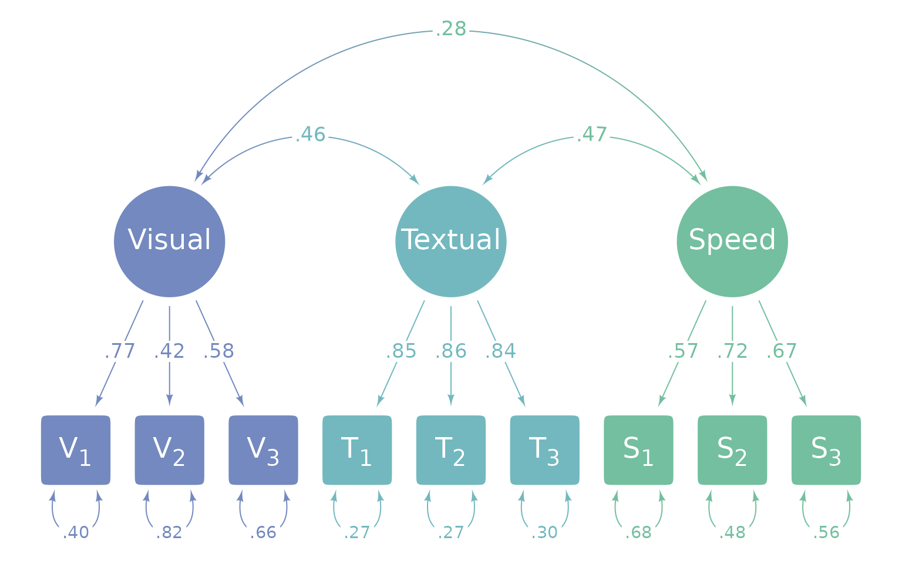
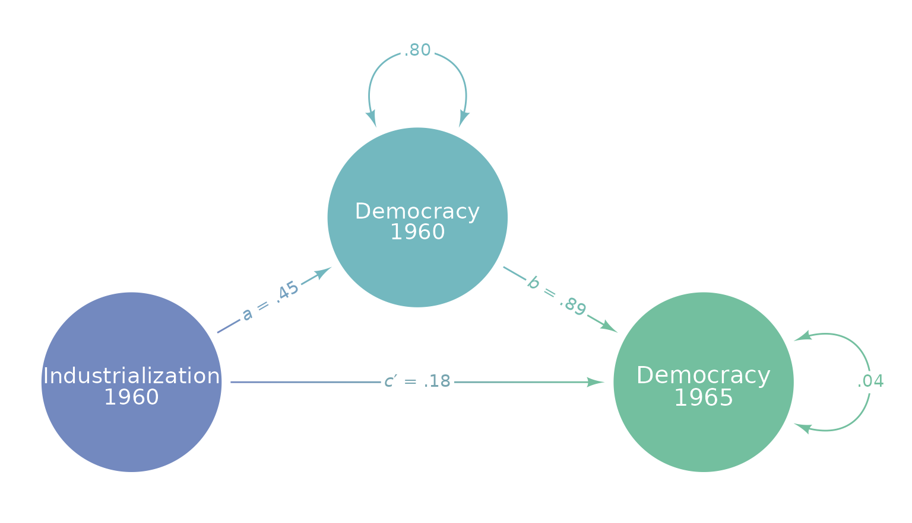

# Structural Equation Model Tables

``` r

library(dplyr)
library(apa7)
library(lavaan)
library(ggdiagram)
apa7_defaults(font_family = "Open Sans", line_spacing = 1.5)
```

Confirmatory factor analyses (CFA) and structural equation models (SEM)
fit with the [lavaan](https://lavaan.ugent.be/) package are usually
reported with at least two tables: one with the fit of the model to the
data, and one with the estimated parameters (factor loadings, regression
paths, and correlations). A CFA can also be reported as a matrix of
loadings, like an exploratory factor analysis, and a sequence of nested
models (e.g., tests of measurement invariance) as a table comparing
their fit. The apa7 package makes all four types of tables:

| Table | Function | Contents |
|----|----|----|
| Model fit | `apa_performance` | *χ*² test, CFI, TLI, RMSEA with its 90% confidence interval, and SRMR |
| Parameter estimates | `apa_parameters` | Standardized loadings, regressions, correlations, and defined parameters (e.g., indirect effects), under headings |
| Loading matrix | `apa_loadings`, `apa_factor_cor` | Standardized CFA loadings with indicators as rows and factors as columns, and the correlations among the factors |
| Model comparison | `apa_performance_comparison` | Fit of nested models (e.g., measurement invariance), each compared with the previous model |

The path diagrams in this article are drawn with the
[ggdiagram](https://wjschne.github.io/ggdiagram/) package, using the
standardized estimates from
[`lavaan::standardizedSolution`](https://rdrr.io/pkg/lavaan/man/standardizedSolution.html).
The code for each diagram can be shown by clicking “Code”.

## Confirmatory Factor Analysis

In the `HolzingerSwineford1939` data set from the lavaan package
([Holzinger & Swineford, 1939](#ref-holzingerStudyFactorAnalysis1939)),
301 seventh- and eighth-grade students took nine mental ability tests.
The tests are thought to measure three abilities: visual (*x*₁ to *x*₃),
textual (*x*₄ to *x*₆), and speed (*x*₇ to *x*₉).

``` r

d_cfa <- HolzingerSwineford1939 |> 
  rename(V1 = x1,
         V2 = x2,
         V3 = x3,
         T1 = x4,
         T2 = x5,
         T3 = x6,
         S1 = x7,
         S2 = x8,
         S3 = x9) |> 
  select(-id:-grade)

model_3 <- "
  Visual  =~ V1 + V2 + V3
  Textual =~ T1 + T2 + T3
  Speed   =~ S1 + S2 + S3
"
fit_3 <- cfa(model_3, data = d_cfa)
```

Code

``` r

# Standardized estimates without leading zeros
std <- standardizedSolution(fit_3)
lbl <- function(x)
  signs::signs(x, accuracy = .01, trim_leading_zeros = TRUE)
loadings <- std |> filter(op == "=~")
correlations <- std |> filter(op == "~~", lhs != rhs)
residuals <- std |> filter(op == "~~", lhs == rhs, lhs %in% colnames(d_cfa))

my_fills <- viridis::viridis(n = 3, begin = .25, end = .65) |>
  class_color(brightness = .75, saturation = .4)

my_cov <- redefault(
  connect,
  arrow_fins = arrowhead(),
  arc_bend = -.75,
  resect = 2
)


ggdiagram(font_family = "Roboto Condensed", font_size = 18) +
  {tests <- ob_ellipse(a = .5, m1 = 16) |>
      ob_array(
        k = 9,
        sep = 0.35,
        label = ob_label(
          paste0(rep(c("V", "T", "S"), each = 3), "~", rep(1:3, 3), "~"),
          color = "white",
          fill = NA,
          nudge_y = -.05
        ),
        color = NA,
        fill = rep(my_fills, each = 3)
      )} +
  {abilities <- ob_circle(
      center = tests[c(2, 5, 8)]@center + ob_point(0, 3),
      radius = 0.8,
      label = ob_label(
        c("Visual", "Textual", "Speed"),
        color = "white",
        fill = NA
      ),
      fill = my_fills,
      color = NA
    )} +
  connect(
    abilities[rep(1:3, each = 3)],
    tests,
    resect = 2,
    linewidth = .35,
    label_sloped = FALSE,
    label = ob_label(lbl(loadings$est.std), 
                     size = 13, 
                     color = tests@fill, 
                     position = .48,
                     label.padding = ggplot2::margin(t = 1.5))
  )@set_label_y() +
  my_cov(
    abilities[c(1, 2, 1)],
    abilities[c(2, 3, 3)],
    resect = 2,
    linewidth = .35,
    label = ob_label(
      lbl(correlations$est.std),
      size = 13,
      color = purrr::map2_chr(abilities[c(2, 3, 3)]@fill, 
                              abilities[c(2, 3, 3)]@fill, 
                              \(x, y) mean_color(c(x, y)))
    )
  ) +
  ob_variance(
    tests,
    where = "south",
    resect = 1,
    theta = 60,
    looseness = 1.5,
    bend = -15,
    linewidth = .35,
    label = ob_label(lbl(residuals$est.std), size = 11, color = tests@fill),
    color = tests@fill
  )
```



Figure 1

Three-Factor Model of the Holzinger and Swineford
([1939](#ref-holzingerStudyFactorAnalysis1939)) Tests

### Model fit

`apa_performance` displays the fit indices that are most often reported.
A list of models gives one row per model, so the three-factor model can
be compared with a model in which a single general factor accounts for
all nine tests:

``` r

model_1 <- "g =~ V1 + V2 + V3 + T1 + T2 + T3 + S1 + S2 + S3"
fit_1 <- cfa(model_1, data = d_cfa)

apa_performance(
  list(`One factor` = fit_1, `Three factors` = fit_3)
) |> 
  apa_flextable(note = TRUE)
```

| Model | χ2 | df | p | CFI | TLI | RMSEA | 90% CI | SRMR |
|----|----|----|----|----|----|----|----|----|
| One factor | 312.26 | 27 | \<.001 | .68 | .57 | .19 | \[.17, .21\] | .14 |
| Three factors |  85.31 | 24 | \<.001 | .93 | .90 | .09 | \[.07, .11\] | .07 |
| Note. N = 301. Estimation used maximum likelihood (ML). CFI = comparative fit index; TLI = Tucker–Lewis index; RMSEA = root mean square error of approximation; CI = confidence interval for RMSEA; SRMR = standardized root mean square residual. |  |  |  |  |  |  |  |  |

Table 1

Fit of the One-Factor and Three-Factor Models of the Ability Tests

The three-factor model fits much better than the one-factor model,
though by conventional standards (e.g., CFI ≥ .95, RMSEA ≤ .06) its fit
is only fair. The values come from
[`lavaan::fitMeasures`](https://rdrr.io/pkg/lavaan/man/fitMeasures.html).
The table note gives the sample size and the estimator and defines the
abbreviations:

Other metrics can be chosen with `metrics` (e.g.,
`metrics = c("Chi2", "Chi2_df", "p_Chi2", "CFI", "AIC", "BIC")`), and
`metrics = "all"` shows all of them.

### Parameter estimates

`apa_parameters` displays fully standardized estimates (*β*), with their
standard errors and *p*-values, under a heading for each kind of
parameter. Paths are labeled with arrows: a factor loading such as
Visual → X1 is read “Visual affects X1,” and a correlation such as
Visual ↔︎ Textual is a two-headed arrow, as in the path diagram.

``` r

apa_parameters(fit_3) |> 
  apa_flextable(note = TRUE)
```

| Variable | β | SE | p |
|----|----|----|----|
| Factor loadings |  |  |  |
|  Visual → V1 | .77 | 0.05 | \<.001 |
|  Visual → V2 | .42 | 0.06 | \<.001 |
|  Visual → V3 | .58 | 0.06 | \<.001 |
|  Textual → T1 | .85 | 0.02 | \<.001 |
|  Textual → T2 | .86 | 0.02 | \<.001 |
|  Textual → T3 | .84 | 0.02 | \<.001 |
|  Speed → S1 | .57 | 0.05 | \<.001 |
|  Speed → S2 | .72 | 0.05 | \<.001 |
|  Speed → S3 | .67 | 0.05 | \<.001 |
| Correlations |  |  |  |
|  Visual ↔ Textual | .46 | 0.06 | \<.001 |
|  Visual ↔ Speed | .47 | 0.07 | \<.001 |
|  Textual ↔ Speed | .28 | 0.07 | \<.001 |
| Note. N = 301. Estimation used maximum likelihood (ML). Estimates are fully standardized, and their standard errors and p-values are for the standardized estimates. β = standardized coefficient. |  |  |  |

Table 2

Standardized Parameter Estimates of the Three-Factor Model

Unstandardized estimates (*B*) are shown with `standardize = FALSE`.
Here, the first loading of each factor was fixed at 1 to give the factor
a scale, so it has no standard error or test, and the note says so.
Other columns, such as *β* next to *B*, *z*, and confidence intervals,
can be added with `predictor_parameters`:

``` r

apa_parameters(
  fit_3,
  standardize = FALSE,
  predictor_parameters = c("Parameter", "Coefficient", "SE", "Std_Coefficient", "z", "p"), 
  note = TRUE
) |> 
  apa_flextable(note = TRUE)
```

| Variable | B | SE | β | z | p |
|----|----|----|----|----|----|
| Factor loadings |  |  |  |  |  |
|  Visual → V1 | 1.00 |  | .77 |  |  |
|  Visual → V2 | 0.55 | 0.10 | .42 |  5.55 | \<.001 |
|  Visual → V3 | 0.73 | 0.11 | .58 |  6.68 | \<.001 |
|  Textual → T1 | 1.00 |  | .85 |  |  |
|  Textual → T2 | 1.11 | 0.07 | .86 | 17.01 | \<.001 |
|  Textual → T3 | 0.93 | 0.06 | .84 | 16.70 | \<.001 |
|  Speed → S1 | 1.00 |  | .57 |  |  |
|  Speed → S2 | 1.18 | 0.16 | .72 |  7.15 | \<.001 |
|  Speed → S3 | 1.08 | 0.15 | .67 |  7.15 | \<.001 |
| Covariances |  |  |  |  |  |
|  Visual ↔ Textual | 0.41 | 0.07 | .46 |  5.55 | \<.001 |
|  Visual ↔ Speed | 0.26 | 0.06 | .47 |  4.66 | \<.001 |
|  Textual ↔ Speed | 0.17 | 0.05 | .28 |  3.52 | \<.001 |
| Note. N = 301. Estimation used maximum likelihood (ML). To set the scale of each factor, the loadings Visual → V1, Textual → T1, and Speed → S1 were fixed at 1. β = standardized coefficient. |  |  |  |  |  |

Table 3

Unstandardized and Standardized Parameter Estimates of the Three-Factor
Model

Variances (labeled “residual” for indicators and outcomes), intercepts,
and thresholds can be added with `variances = TRUE`,
`intercepts = TRUE`, and `thresholds = TRUE`.

### Loading matrix

A CFA can also be reported in the matrix form used for exploratory
factor analysis, with a row for each indicator and a column for each
factor. `apa_loadings` shows the standardized loadings and leaves blank
the loadings fixed at 0. As in exploratory factor analysis, the rows are
grouped by the factor with each indicator’s largest loading and sorted
by the size of that loading (`sort_loading = FALSE` keeps the order of
the model syntax). Suppose that Speeded Discrimination (*S*₃,
distinguishing straight from curved capital letters) loads on Visual as
well as on Speed:

``` r

model_3x <- "
  Visual  =~ V1 + V2 + V3 + S3
  Textual =~ T1 + T2 + T3
  Speed   =~ S1 + S2 + S3
"
fit_3x <- cfa(model_3x, data = d_cfa)

apa_loadings(fit_3x, communality = TRUE) |>
  # Recode variable names to test names
  mutate(Variable = case_match(
    Variable,
    "V1" ~ "Visual Perception",
    "V2" ~ "Cubes",
    "V3" ~ "Lozenges",
    "T1" ~ "Paragraph Comprehension",
    "T2" ~ "Sentence Completion",
    "T3" ~ "Word Meaning",
    "S1" ~ "Speeded Addition",
    "S2" ~ "Speeded Counting of Dots",
    "S3" ~ "Speeded Discrimination"
  )) |>
  apa_flextable(note = TRUE)
```

    Warning: There was 1 warning in `mutate()`.
    ℹ In argument: `Variable = case_match(...)`.
    Caused by warning:
    ! `case_match()` was deprecated in dplyr 1.2.0.
    ℹ Please use `recode_values()` instead.

| Variable | Visual | Textual | Speed | h2 |
|----|----|----|----|----|
| Visual Perception | .76 |  |  | .58 |
| Lozenges | .59 |  |  | .35 |
| Cubes | .44 |  |  | .19 |
| Sentence Completion |  | .86 |  | .73 |
| Paragraph Comprehension |  | .85 |  | .72 |
| Word Meaning |  | .84 |  | .70 |
| Speeded Counting of Dots |  |  | .80 | .63 |
| Speeded Addition |  |  | .61 | .37 |
| Speeded Discrimination | .38 |  | .45 | .45 |
| Note. N = 301. Estimation used maximum likelihood (ML). Loadings are fully standardized estimates from a confirmatory factor analysis. Blank cells are loadings fixed at 0. h2 = communality. |  |  |  |  |

Table 4

Loadings of the Three-Factor Model With a Cross-Loading

The communality (*h*²) is the proportion of variance in each indicator
explained by the factors (*R*²). Rows for the variance explained by each
factor can be added with `variance = TRUE`, and `apa_factor_cor` shows
the correlations among the factors:

``` r

apa_factor_cor(fit_3x) |>
  apa_flextable(note = TRUE)
```

| Factor | 1 | 2 | 3 |
|----|----|----|----|
| 1. Visual | — |  |  |
| 2. Textual |  .45 | — |  |
| 3. Speed |  .30 |  .21 | — |
| Note. N = 301. Estimation used maximum likelihood (ML). Correlations among the latent variables are from the fully standardized solution. |  |  |  |

Table 5

Correlations Among the Visual, Textual, and Speed Factors

### Robust estimation and missing data

When the model is fit with a robust estimator (e.g.,
`estimator = "MLR"`, or `"WLSMV"` for ordinal indicators),
`apa_performance` shows the scaled *χ*² test and the robust versions of
CFI, TLI, and RMSEA, and the note says so. With `missing = "fiml"`, the
note also says that missing data were handled with full information
maximum likelihood.

``` r

fit_mlr <- cfa(
  model_3,
  data = d_cfa,
  estimator = "MLR",
  missing = "fiml"
)
apa_performance(fit_mlr) |>
  apa_flextable(note = TRUE)
```

| χ2 | df | p | CFI | TLI | RMSEA | 90% CI | SRMR |
|----|----|----|----|----|----|----|----|
| 87.13 | 24 | \<.001 | .93 | .90 | .09 | \[.07, .11\] | .06 |
| Note. N = 301. Estimation used robust maximum likelihood (MLR), as described by Yuan & Bentler ([2000](#ref-yuanThreeLikelihoodbasedMethods2000)). χ2 is a scaled test statistic, and CFI, TLI, and RMSEA are the robust versions. Missing data were handled with full information maximum likelihood. CFI = comparative fit index; TLI = Tucker–Lewis index; RMSEA = root mean square error of approximation; CI = confidence interval for RMSEA; SRMR = standardized root mean square residual. |  |  |  |  |  |  |  |

Table 6

Fit of the Three-Factor Model With Robust Maximum Likelihood Estimation

### Comparing nested models: measurement invariance

Do the tests measure the same abilities in the same way at both schools
in the study (Pasteur and Grant-White)? A measurement invariance
analysis fits a sequence of multiple-group models, each more constrained
than the one before it:

1.  **Configural**: the same factor structure in both groups
2.  **Metric**: loadings equal across groups
    (`group.equal = "loadings"`)
3.  **Scalar**: loadings and intercepts equal across groups

``` r

d_mi <- d_cfa |>
  mutate(school = HolzingerSwineford1939$school)

fit_configural <- cfa(model_3, data = d_mi, group = "school")
fit_metric <- cfa(model_3, data = d_mi, group = "school",
                  group.equal = "loadings")
fit_scalar <- cfa(model_3, data = d_mi, group = "school",
                  group.equal = c("loadings", "intercepts"))
```

`apa_performance_comparison` shows the fit of each model, and compares
each model with the one before it. The comparison has the *χ*²
difference test from
[`lavaan::lavTestLRT`](https://rdrr.io/pkg/lavaan/man/lavTestLRT.html)
and the changes in CFI and RMSEA, which are often used alongside it
because the *χ*² test is sensitive to sample size. The models should be
listed from the least to the most constrained.

``` r

apa_performance_comparison(
  Configural = fit_configural,
  Metric = fit_metric,
  Scalar = fit_scalar
) |>
  apa_flextable(note = TRUE)
```

| Model | χ2 | df | CFI | RMSEA | 90% CI | SRMR | Change from previous model |  |  |  |  |
|----|----|----|----|----|----|----|----|----|----|----|----|
|  |  |  |  |  |  |  | Δχ2 | Δdf | p | ΔCFI | ΔRMSEA |
| Configural | 115.85 | 48 | .92 | .10 | \[.07, .12\] | .07 |  |  |  |  |  |
| Metric | 124.04 | 54 | .92 | .09 | \[.07, .11\] | .07 |  8.19 | 6 |  .22  | −.002 | −.004 |
| Scalar | 164.10 | 60 | .88 | .11 | \[.09, .13\] | .08 | 40.06 | 6 | \<.001 | −.038 |  .015 |
| Note. N = 301. Estimation used maximum likelihood (ML). CFI = comparative fit index; RMSEA = root mean square error of approximation; CI = confidence interval for RMSEA; SRMR = standardized root mean square residual. Δ = change from the previous model. Δχ2 is a likelihood ratio (χ2 difference) test. |  |  |  |  |  |  |  |  |  |  |  |

Table 7

Measurement Invariance of the Three-Factor Model Across Schools

Constraining the loadings to be equal did not worsen the fit much, so
metric invariance is plausible. Constraining the intercepts worsened the
fit considerably (e.g., a drop in CFI larger than the .01 suggested by
[Cheung & Rensvold,
2002](#ref-cheungEvaluatingGoodnessofFitIndexes2002)), so scalar
invariance does not hold: at least some tests have different intercepts
at the two schools.

With a robust estimator (e.g., `estimator = "MLR"`), the difference test
is scaled (e.g., the Satorra–Bentler scaled difference test), and the
note names it. Other metrics, such as `"deltaTLI"` and `"deltaSRMR"`,
can be chosen with `metrics`, and `metrics = "all"` shows all of them.

### Multiple-group parameter estimates

`apa_parameters` shows the estimates of a multiple-group model side by
side, with a column spanner for each group, so the groups can be
compared row by row. Here are the estimates of the metric model:

``` r

apa_parameters(fit_metric) |>
  apa_flextable(note = TRUE)
```

| Variable | Pasteur |  |  |  | Grant-White |  |  |
|----|----|----|----|----|----|----|----|
|  | β | SE | p |  | β | SE | p |
| Factor loadings |  |  |  |  |  |  |  |
|  Visual → V1 | .77 | 0.06 | \<.001 |  | .73 | 0.06 | \<.001 |
|  Visual → V2 | .43 | 0.06 | \<.001 |  | .47 | 0.07 | \<.001 |
|  Visual → V3 | .60 | 0.06 | \<.001 |  | .65 | 0.06 | \<.001 |
|  Textual → T1 | .82 | 0.03 | \<.001 |  | .86 | 0.03 | \<.001 |
|  Textual → T2 | .82 | 0.03 | \<.001 |  | .86 | 0.03 | \<.001 |
|  Textual → T3 | .86 | 0.03 | \<.001 |  | .80 | 0.03 | \<.001 |
|  Speed → S1 | .51 | 0.06 | \<.001 |  | .67 | 0.06 | \<.001 |
|  Speed → S2 | .68 | 0.06 | \<.001 |  | .79 | 0.05 | \<.001 |
|  Speed → S3 | .58 | 0.06 | \<.001 |  | .70 | 0.06 | \<.001 |
| Correlations |  |  |  |  |  |  |  |
|  Visual ↔ Textual | .48 | 0.09 | \<.001 |  | .54 | 0.09 | \<.001 |
|  Visual ↔ Speed | .34 | 0.11 |  .003 |  | .54 | 0.09 | \<.001 |
|  Textual ↔ Speed | .33 | 0.10 | \<.001 |  | .34 | 0.09 | \<.001 |
| Note. N = 301 (Pasteur: n = 156; Grant-White: n = 145). Estimation used maximum likelihood (ML). Estimates are fully standardized, and their standard errors and p-values are for the standardized estimates. Loadings were constrained to be equal across groups. Standardized estimates of equal parameters can differ across groups because the groups’ variances differ. β = standardized coefficient. |  |  |  |  |  |  |  |

Table 8

Parameter Estimates of the Metric Invariance Model by School

The note gives the size of each group and says which parameters were
constrained to be equal. The unstandardized loadings of the metric model
are equal at the two schools, but the standardized loadings differ,
because each school’s estimates are standardized with that school’s
variances. With many groups, or with more columns, `groups = "rows"`
stacks the groups, each under a heading.

## Structural Equation Models

Does industrialization lead to democracy? In the classic
`PoliticalDemocracy` data set ([Bollen,
1989](#ref-bollenStructuralEquationsLatent1989)) from the lavaan
package, industrialization in 1960 was measured in 75 developing
countries with three indicators (*x*₁ to *x*₃), and political democracy
was measured in 1960 and in 1965 with four indicators each (*y*₁ to *y*₄
and *y*₅ to *y*₈). The same democracy indicator measured in different
years can share specific variance, so the residuals of matching
indicators are allowed to correlate.

In this model, industrialization affects democracy in 1965 directly
(*c*′) and indirectly, through democracy in 1960 (*a* × *b*). The labels
`a`, `b`, and `c` name the paths, and `:=` defines the indirect and
total effects from them.

``` r

model_pd <- "
  # Measurement model
  ind60 =~ x1 + x2 + x3
  dem60 =~ y1 + y2 + y3 + y4
  dem65 =~ y5 + y6 + y7 + y8

  # Structural model
  dem60 ~ a * ind60
  dem65 ~ c * ind60 + b * dem60

  # Correlated residuals of matching indicators
  y1 ~~ y5
  y2 ~~ y4 + y6
  y3 ~~ y7
  y4 ~~ y8
  y6 ~~ y8

  # Defined parameters
  indirect := a * b
  total := c + a * b
"
fit_pd <- sem(model_pd, data = PoliticalDemocracy)
```

Code

``` r

std_pd <- standardizedSolution(fit_pd)
path <- function(lhs, rhs) {
  std_pd |> 
    filter(op == "~", lhs == !!lhs, rhs == !!rhs) |> 
    pull(est.std) |> 
    lbl()
}
disturbance <- function(x) {
  std_pd |> 
    filter(op == "~~", lhs == x, rhs == x) |> 
    pull(est.std) |> 
    lbl()
}

lb <- redefault(
  ob_label,
  nudge_y = -.1,
  fill = NA,
  color = "white",
  size = 14,
  lineheight = .95
)
lat <- redefault(ob_circle, radius = 1.5, color = NA)

plb <- redefault(ob_label, size = 11, position = .47)

ggdiagram(font_family = "Roboto Condensed", font_size = 16) +
  {
    ind60 <- lat(
      fill = my_fills[1],
      label = lb("Industrialization<br>1960"))
  } +
  {
    dem60 <- lat(
      fill = my_fills[2], 
      label = lb("Democracy<br>1960")
    ) |>
      place(ind60, degree(30), sep = 2.5)
  } +
  {
    dem65 <- lat(
      fill = my_fills[3],
      label = lb(
        "Democracy<br>1965",
        nudge_y = -.1,
        fill = NA,
        color = "white",
        size = 15
      )
    ) |>
      place(dem60, degree(-30), sep = 2.5)
  } +
  connect(
    ind60,
    dem60,
    resect = 2,
    label_sloped = TRUE,
    label = plb(
      paste0("*a* = ", path("dem60", "ind60")), 
      color = mean_color(c(ind60@fill, dem60@fill))
      )
  ) +
  connect(
    dem60,
    dem65,
    resect = 2,
    label_sloped = TRUE,
    label = plb(
      paste0("*b* = ", path("dem65", "dem60")),
      color = mean_color(c(dem60@fill, dem65@fill))
      )
  ) +
  connect(
    ind60,
    dem65,
    resect = 2,
    label_sloped = TRUE,
    label = plb(
      paste0("*c*&prime; = ", path("dem65", "ind60")),
      position = .5,
      color = mean_color(c(ind60@fill, dem65@fill))
    )
  ) +
  ob_variance(
    dem60,
    where = "north",
    resect = 2,
    looseness = 1.1,
    color = dem60@fill,
    label = ob_label(
      disturbance("dem60"), 
      color = dem60@fill, 
      size = 11)
  ) +
  ob_variance(
    dem65,
    where = "east",
    resect = 2,
    looseness = 1.1,
    color = dem65@fill,
    label = ob_label(
      disturbance("dem65"), 
      color = dem65@fill, 
      size = 11)
  )
```



Figure 2

Structural Model of Industrialization and Democracy

For clarity, the diagram shows only the structural model. The
disturbances (the two-headed arrows on the democracy factors) are the
proportions of variance not explained by the paths into them.

### Model fit

``` r

apa_performance(fit_pd)
```

| χ2    | df  | p   | CFI  | TLI | RMSEA | 90% CI       | SRMR |
|-------|-----|-----|------|-----|-------|--------------|------|
| 38.13 | 35  | .33 | 1.00 | .99 | .03   | \[.00, .09\] | .04  |

Table 9

Fit of the Political Democracy Model

The model fits well. When the lower bound of the RMSEA interval is 0, it
is shown as .00.

### Parameter estimates

The parameter table has a section for each kind of parameter in the
model: the measurement model’s loadings, the structural model’s
regressions, the correlated residuals, and the defined parameters.
Regressions are labeled with the arrow pointing from predictor to
outcome (Dem65 ← Dem60 is read “Dem65 is predicted by Dem60”).

``` r

tbl_pd <- apa_parameters(fit_pd, starred = "p")
tbl_pd
```

| Variable           | β   | SE   | p            |
|--------------------|-----|------|--------------|
| Factor loadings    |     |      |              |
|  Ind60 → X1        | .92 | 0.02 | \<.001\*\*\* |
|  Ind60 → X2        | .97 | 0.02 | \<.001\*\*\* |
|  Ind60 → X3        | .87 | 0.03 | \<.001\*\*\* |
|  Dem60 → Y1        | .85 | 0.04 | \<.001\*\*\* |
|  Dem60 → Y2        | .72 | 0.06 | \<.001\*\*\* |
|  Dem60 → Y3        | .72 | 0.06 | \<.001\*\*\* |
|  Dem60 → Y4        | .85 | 0.04 | \<.001\*\*\* |
|  Dem65 → Y5        | .81 | 0.05 | \<.001\*\*\* |
|  Dem65 → Y6        | .75 | 0.06 | \<.001\*\*\* |
|  Dem65 → Y7        | .82 | 0.04 | \<.001\*\*\* |
|  Dem65 → Y8        | .83 | 0.04 | \<.001\*\*\* |
| Regressions        |     |      |              |
|  Dem60 ← Ind60     | .45 | 0.10 | \<.001\*\*\* |
|  Dem65 ← Ind60     | .18 | 0.07 |  .01 \*\*    |
|  Dem65 ← Dem60     | .89 | 0.05 | \<.001\*\*\* |
| Correlations       |     |      |              |
|  Y1 ↔ Y5           | .30 | 0.14 |  .03 \*      |
|  Y2 ↔ Y4           | .27 | 0.12 |  .02 \*      |
|  Y2 ↔ Y6           | .36 | 0.10 | \<.001\*\*\* |
|  Y3 ↔ Y7           | .19 | 0.13 |  .15         |
|  Y4 ↔ Y8           | .11 | 0.13 |  .41         |
|  Y6 ↔ Y8           | .34 | 0.11 |  .002\*\*    |
| Defined parameters |     |      |              |
|  Indirect          | .40 | 0.09 | \<.001\*\*\* |
|  Total             | .58 | 0.09 | \<.001\*\*\* |

Table 10

Standardized Parameter Estimates of the Political Democracy Model With
Significance Stars

Most of industrialization’s effect on democracy in 1965 is indirect:
industrialization predicts democracy in 1960, which strongly predicts
democracy in 1965.

### Bootstrapped indirect effects

Because the sampling distribution of an indirect effect is usually
skewed, indirect effects are often tested with bootstrapped confidence
intervals. With `se = "bootstrap"`, lavaan’s unstandardized confidence
intervals are bootstrap percentile intervals. Show them with
`standardize = FALSE` and `"CI"`:

``` r

set.seed(2026)
fit_pd_boot <- sem(
  model_pd,
  data = PoliticalDemocracy,
  se = "bootstrap",
  bootstrap = 500
)
apa_parameters(
  fit_pd_boot,
  standardize = FALSE,
  predictor_parameters = c("Parameter", "Coefficient", "SE", "CI", "Std_Coefficient")
) |> 
  apa_flextable(note = TRUE)
```

| Variable | B | SE | 95% CI | β |
|----|----|----|----|----|
| Factor loadings |  |  |  |  |
|  Ind60 → X1 | 1.00 |  |  | .92 |
|  Ind60 → X2 | 2.18 | 0.15 | \[ 1.91, 2.48\] | .97 |
|  Ind60 → X3 | 1.82 | 0.13 | \[ 1.54, 2.10\] | .87 |
|  Dem60 → Y1 | 1.00 |  |  | .85 |
|  Dem60 → Y2 | 1.26 | 0.16 | \[ 0.96, 1.60\] | .72 |
|  Dem60 → Y3 | 1.06 | 0.14 | \[ 0.81, 1.38\] | .72 |
|  Dem60 → Y4 | 1.26 | 0.16 | \[ 0.99, 1.64\] | .85 |
|  Dem65 → Y5 | 1.00 |  |  | .81 |
|  Dem65 → Y6 | 1.19 | 0.18 | \[ 0.83, 1.63\] | .75 |
|  Dem65 → Y7 | 1.28 | 0.18 | \[ 0.97, 1.70\] | .82 |
|  Dem65 → Y8 | 1.27 | 0.20 | \[ 0.92, 1.73\] | .83 |
| Regressions |  |  |  |  |
|  Dem60 ← Ind60 | 1.48 | 0.34 | \[ 0.86, 2.16\] | .45 |
|  Dem65 ← Ind60 | 0.57 | 0.25 | \[ 0.08, 1.06\] | .18 |
|  Dem65 ← Dem60 | 0.84 | 0.09 | \[ 0.67, 1.01\] | .89 |
| Covariances |  |  |  |  |
|  Y1 ↔ Y5 | 0.62 | 0.48 | \[−0.34, 1.57\] | .30 |
|  Y2 ↔ Y4 | 1.31 | 0.78 | \[−0.18, 2.85\] | .27 |
|  Y2 ↔ Y6 | 2.15 | 0.85 | \[ 0.48, 3.86\] | .36 |
|  Y3 ↔ Y7 | 0.79 | 0.62 | \[−0.52, 2.06\] | .19 |
|  Y4 ↔ Y8 | 0.35 | 0.44 | \[−0.49, 1.18\] | .11 |
|  Y6 ↔ Y8 | 1.36 | 0.76 | \[−0.01, 2.90\] | .34 |
| Defined parameters |  |  |  |  |
|  Indirect | 1.24 | 0.34 | \[ 0.65, 2.00\] | .40 |
|  Total | 1.81 | 0.41 | \[ 1.01, 2.67\] | .58 |
| Note. N = 75. Estimation used maximum likelihood (ML). Standard errors are based on 500 bootstrap samples, and confidence intervals are bootstrap percentile intervals. To set the scale of each factor, the loadings Ind60 → X1, Dem60 → Y1, and Dem65 → Y5 were fixed at 1. CI = confidence interval; β = standardized coefficient. |  |  |  |  |

Table 11

Parameter Estimates of the Political Democracy Model With Bootstrap
Confidence Intervals

The interval for the indirect effect excludes 0. The note gives the
number of bootstrap samples that lavaan used and says that the intervals
are percentile intervals:

## Table Notes

As with other apa7 tables, `apa_note` writes the note from what the
table records, and the note can be used in the `apa-note` chunk option
with [apaquarto](https://wjschne.github.io/apaquarto/) (make the table
in an earlier chunk, and write
[`apa7::apa_note`](https://wjschne.github.io/apa7/reference/apa_note.md)):

```` markdown
```{r}
#| label: tbl-pd
#| tbl-cap: Standardized Parameter Estimates of the Political Democracy Model
#| apa-note: !expr apa7::apa_note(tbl_pd)
tbl_pd
```
````

| Variable           | β   | SE   | p            |
|--------------------|-----|------|--------------|
| Factor loadings    |     |      |              |
|  Ind60 → X1        | .92 | 0.02 | \<.001\*\*\* |
|  Ind60 → X2        | .97 | 0.02 | \<.001\*\*\* |
|  Ind60 → X3        | .87 | 0.03 | \<.001\*\*\* |
|  Dem60 → Y1        | .85 | 0.04 | \<.001\*\*\* |
|  Dem60 → Y2        | .72 | 0.06 | \<.001\*\*\* |
|  Dem60 → Y3        | .72 | 0.06 | \<.001\*\*\* |
|  Dem60 → Y4        | .85 | 0.04 | \<.001\*\*\* |
|  Dem65 → Y5        | .81 | 0.05 | \<.001\*\*\* |
|  Dem65 → Y6        | .75 | 0.06 | \<.001\*\*\* |
|  Dem65 → Y7        | .82 | 0.04 | \<.001\*\*\* |
|  Dem65 → Y8        | .83 | 0.04 | \<.001\*\*\* |
| Regressions        |     |      |              |
|  Dem60 ← Ind60     | .45 | 0.10 | \<.001\*\*\* |
|  Dem65 ← Ind60     | .18 | 0.07 |  .01 \*\*    |
|  Dem65 ← Dem60     | .89 | 0.05 | \<.001\*\*\* |
| Correlations       |     |      |              |
|  Y1 ↔ Y5           | .30 | 0.14 |  .03 \*      |
|  Y2 ↔ Y4           | .27 | 0.12 |  .02 \*      |
|  Y2 ↔ Y6           | .36 | 0.10 | \<.001\*\*\* |
|  Y3 ↔ Y7           | .19 | 0.13 |  .15         |
|  Y4 ↔ Y8           | .11 | 0.13 |  .41         |
|  Y6 ↔ Y8           | .34 | 0.11 |  .002\*\*    |
| Defined parameters |     |      |              |
|  Indirect          | .40 | 0.09 | \<.001\*\*\* |
|  Total             | .58 | 0.09 | \<.001\*\*\* |

Table 12

Standardized Parameter Estimates of the Political Democracy Model

*Note*. *N* = 75. Estimation used maximum likelihood (ML). Estimates are
fully standardized, and their standard errors and *p*-values are for the
standardized estimates. β = standardized coefficient. ^(\* )*p* ≤ .05.
^(\*\* )*p* ≤ .01. ^(\*\*\* )*p* ≤ .001.

Without apaquarto, `apa_flextable(tbl, note = TRUE)` puts the note below
the table.

## References

Bollen, K. A. (1989). *Structural equations with latent variables*.
Wiley. <https://doi.org/10.1002/9781118619179>

Cheung, G. W., & Rensvold, R. B. (2002). Evaluating goodness-of-fit
indexes for testing measurement invariance. *Structural Equation
Modeling*, *9*(2), 233–255. <https://doi.org/10.1207/S15328007SEM0902_5>

Holzinger, K. J., & Swineford, F. (1939). *A study in factor analysis:
The stability of a bi-factor solution*. University of Chicago Press.

Yuan, K.-H., & Bentler, P. M. (2000). Three likelihood-based methods for
mean and covariance structure analysis with nonnormal missing data.
*Sociological Methodology*, *30*(1), 165–200.
<https://doi.org/10.1111/0081-1750.00078>
